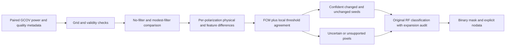

# SAR denoising and pseudo-label refinement: applicability review

Updated 2026-11-15. This reviews the user-supplied literature synthesis against the actual GCOV/UCDFormer workflow. It is not evidence that any new denoiser improves our results.

## What is supported and what needs correction

- **Speckle2Void is relevant:** [original paper](https://arxiv.org/html/2007.02075), Molini et al., preprint 2020/journal 2021. It models SAR speckle with a Bayesian blind-spot method, addresses spatial correlation using whitening and variable blind spots, and combines a likelihood objective with TV. It is not generic masked-pixel MSE applied without a noise model. Its real-data experiments are not a validation on our NISAR GCOV products.
- **Generic Noise2Void has assumptions:** [CVPR paper](https://openaccess.thecvf.com/content_CVPR_2019/papers/Krull_Noise2Void_-_Learning_Denoising_From_Single_Noisy_Images_CVPR_2019_paper.pdf). Conditional pixel-noise independence matters. GCOV resampling/multilooking can create spatial dependence, so a center-pixel blind spot alone is not a sufficient justification. An architecture-level blind spot and a training mask are related implementations, not automatically the same guarantee at inference.
- **Noise2Fringe is a different data domain:** the [authors' institutional account](https://www.smu.edu/-/media/site/provost/datascienceinstitute/2024-and-on/odsrci-spring-2025-newsletter.pdf) describes interferometric phase and persistent scatterers. False fringes in incoherent interferograms should not be presented as evidence about intensity artifacts in GCOV. Estimating amplitude dispersion/persistent-scatterer reliability generally needs a suitable temporal stack, not only a changed pre/post pair.
- **CF-LPSICM exists:** [Huang et al. 2025](https://www.mdpi.com/2072-4292/17/5/840). Curvelet fusion and spatial/patch-similarity clustering are relevant alternatives to independent scalar clustering, but this is not the current UCDFormer architecture. High-frequency content contains both noise and genuine edges; separating frequency bands does not uniquely separate noise from signal.
- **TSPLR identified:** Fang et al. 2024, DOI `10.1109/LGRS.2024.3368455`; [author affiliation record](https://cise.sdust.edu.cn/home/Page/teacher_detail/catId/31/id/141.html) verifies bibliographic identity. Full primary-method text was not accessible in the current tool. Do not attribute EMA teacher updates, a particular confidence split or a loss to it from acronym alone.
- **PINN-inspired work identified:** Jang and Kim 2026, DOI `10.1109/JSTARS.2026.3694048`; [author institution abstract](https://scholarworks.sogang.ac.kr/item/b81318ba-bd95-416c-b2b4-49cd049f12cc) supports dual-TV, speckle-aware self-supervision and adaptive structural weighting. It explicitly distinguishes the method from solving a forward physical PDE. Full implementation and GCOV transfer were not verified.
- **WASNet identified:** [publisher article](https://doi.org/10.1080/01431161.2026.2697506), Ihmeida et al. 2026. Accessible publisher abstract confirms wavelet downsampling/reconstruction and attention. Full text returned access restrictions; exact supervision, losses and availability of usable pretrained weights are not established here. It is not automatically a plug-in despeckler for our pipeline.
- A Song et al. feature-screened/structure-constrained deep-forest title was found, but exact primary-source details for the supplied SC-FS-DF row were not established. Other author/year-only citations in the supplied text lack enough bibliographic information to support their specific loss/EMA claims. This is incomplete verification, not a claim that those papers do not exist.

## Important mathematical distinctions

For positive intensity `I = X*N`, `log(I) = log(X) + log(N)`. A two-date log-ratio is `log(X2/X1) + log(N2/N1)`. Logging does not remove speckle, prove Gaussianity, make adjacent noise independent, or ensure a difference is caused by the event. The speckle log mean/variance depends on its distribution and looks; dates with different processing/noise statistics may retain bias. Zero, negative, fill and near-noise-floor samples require explicit treatment.

The dB difference `10*log10(I2) - 10*log10(I1)` is a scaled log-ratio. Thus keeping log-ratio for analytical scoring is compatible with showing non-dB composites and normalized differences to the user. Recoloring a log-ratio does not add independent observations.

Do not use the post image as a clean/noisy target for the pre image in Noise2Noise-style training: the physical surface may have changed. A shared, per-date denoiser must preserve temporal contrast; independent histogram matching or a cross-date averaging filter can erase it. Multi-temporal background estimation should exclude event-contaminated dates and requires more than two images for meaningful stability characterization.

## What our actual input/model does

GCOV is already geocoded, terrain corrected and multilooked. Etna frequency-A `numberOfLooks` over the actual crop: p05 4.33, median 9.79, p95 14.27. This product metadata is **not an independent estimate of effective number of looks (ENL)**. Spatial correlation, adaptive weighting and texture affect its interpretation. Do not blindly apply a single-look noise likelihood or use the nominal layer as a perfect independent-look count.

The current UCDFormer translator learns style/content objectives; its final random forest learns from confident pseudo-labels. Symmetric cross-entropy, MSE/KL classification losses, EMA teacher updates and CNN refinement are not RF options. Adding them requires a new neural classifier or a different training loop, and must be named as an extension. Clustering memberships and model votes are uncalibrated confidence surrogates, not ground truth.

First Etna run had 160 positive seeds but 28,479 final changed pixels over supported coverage. RF extrapolation from sparse, potentially unrepresentative seeds is a major hypothesis for the broad mask, alongside terrain/speckle/optical feature mismatch. Denoising alone may not fix that behavior. More filters must not obscure this diagnostic.

## Recommended next experiment within the deadline

1. Preserve current outputs as v1. Compare original GCOV against a common 3×3 mask-aware linear-power mean at both dates; optionally one SAR-specific edge-preserving filter only after its parameters/statistics are justified. Do not train a second network before this ablation.
2. Inspect power, temporal composites, normalized signed change and analytical log-ratio separately for each polarization. Do not fuse channels before checking whether they agree or carry different signal.
3. Produce separate maps for Gaussian adaptive-only candidates, strict FCM/adaptive changed seeds, uncertain pixels, final RF predictions, and conservative score-supported RF variants. Record seed class balance, spatial coverage and expansion, not just changed fraction.
4. Compare a small declared set of robust local median/MAD thresholds and physical relative-change floors, with window sizes in meters. MAD estimates on textured neighborhoods are not calibrated statistical tests; avoid significance/probability language. A global absolute floor is unit-specific: dB, normalized ratio and VGG L2 require different parameters.
5. Leave disagreement and unsupported areas explicit. No automatic rule should force a positive class in a no-change pair. Erode or confidence-reduce ambiguous boundaries only as a declared variant, with physical area/width units.
6. If changing the model's actual input filter/scaling, retrain or re-adapt consistently; do not feed a newly filtered distribution into the old model and call it the same controlled experiment. A denoised teacher score for RF is a separate hybrid variant.

## Denoising evaluation without clean labels

Use multiple diagnostics: ratio/residual images for leaked structures, changes in homogeneous-region variance, mean radiometric preservation, edge/target retention, temporal contrast at independently supported features, and threshold/seed stability. ENL `mean²/variance` is interpretable only on genuinely homogeneous regions; smoothing can inflate it while destroying useful detail. PSNR/SSIM require a defensible reference and are not available merely because two timestamps exist. No-reference diagnostics do not establish change-detection accuracy.

A Speckle2Void-inspired follow-up would need: actual GCOV noise/autocorrelation assessment; look/statistics-aware likelihood; blind-spot width chosen against correlation; identical preprocessing at both dates; train/validation separation; and comparison against simple filters plus event-feature preservation checks. Treat whitening choices carefully: the original complex-data procedure cannot be assumed available from two diagonal GCOV power layers.

## Current recommended workflow

This is the practical refinement plan. Blind-spot networks, teacher–student models and wavelet architectures remain separate research candidates, not a stack of mandatory modules for a 13-hour delivery.
