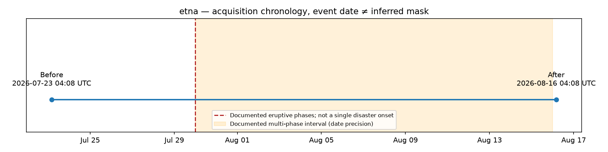
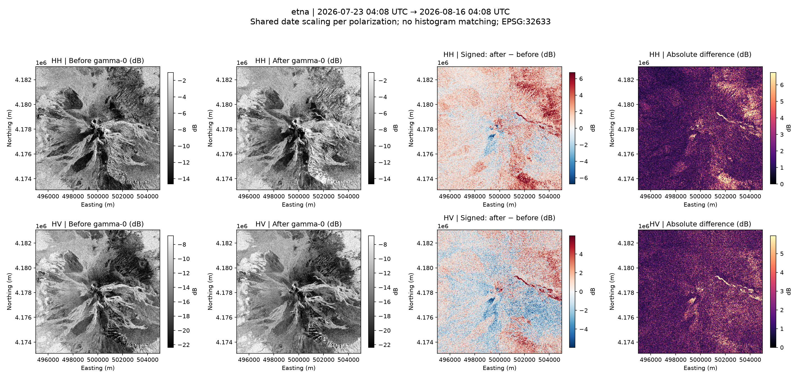
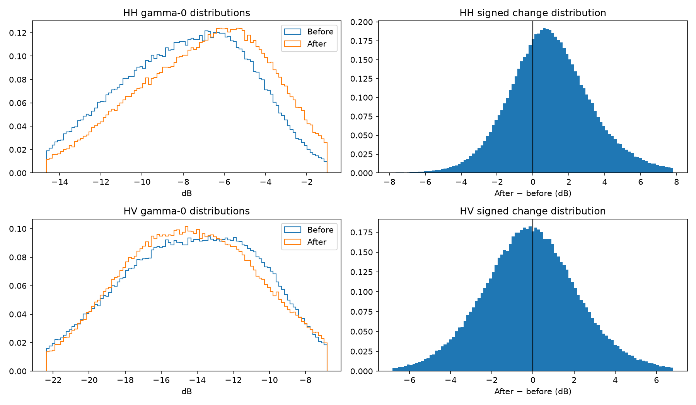
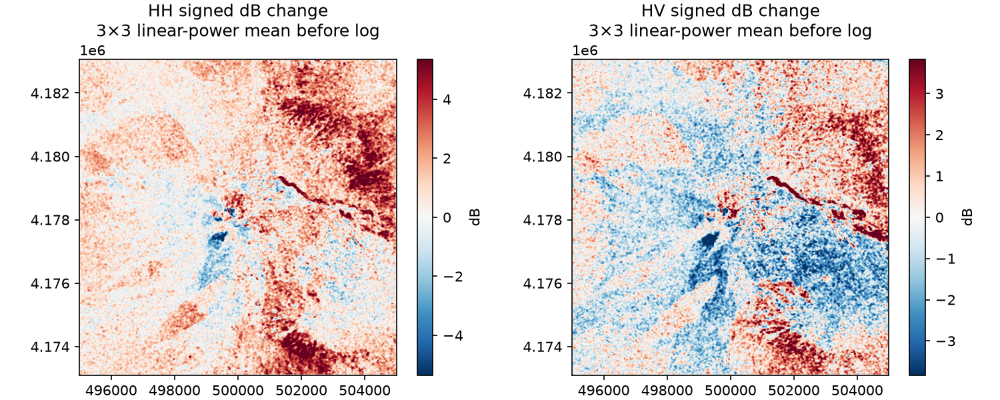
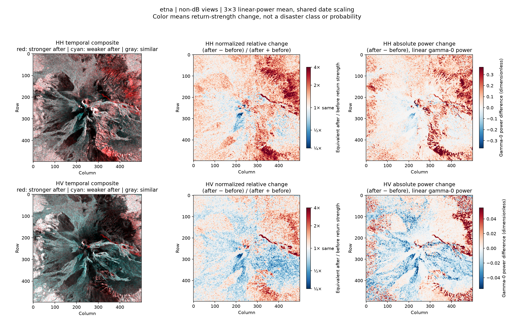

# etna: before/after NISAR EDA

Before: **2026-07-23 04:08:29 UTC**. After: **2026-08-16 04:08:28 UTC**.

Event context: [Documented eruptive phases; not a single disaster onset](https://ingvvulcani.com/2026/08/22/etna-la-calda-estate-del-2026/).

July 23 precedes selected late-July/August phases, but Etna was already active earlier in July. August 16 captures part of a multi-phase interval, not necessarily its end.

Proposed bbox `[west,south,east,north]`: `[14.943194446669025, 37.70508444125045, 15.056805553330975, 37.79491555874955]`. Common valid pixels: 100.00%. Frequency A; EPSG:32633.

These are measured polarization-intensity comparisons, not RGB photographs or validated event masks. Each polarization uses exactly the same dB display limits at both dates. Red signed differences mean stronger post-event returns; blue means weaker. Both signs can represent change.

The filtered figure averages 3×3 linear-power neighborhoods before taking logarithms; it is an EDA sensitivity check, not a hidden change to model inputs.

Statistics and chronology checks: [eda.json](eda.json). No accuracy metric or calibrated change probability is inferred from these figures.

## Non-dB companion views

These use a 3×3 mean of linear power before comparison; model inputs and prior results are unchanged. Relative-map ticks show fold change: ½× means half the pre-image return; 2× means twice. The score is bounded, not a probability. Very dark pixels remain susceptible to relative-change noise. Linear-change GeoTIFFs retain the full unclipped values. Red/cyan are explicitly assigned and must not be interpreted as fire/flood labels.

[Numerical display metadata](non_db_metadata.json). Method rationale: [ASF SAR scale guide](https://hyp3-docs.asf.alaska.edu/hyp3-docs/guides/introduction_to_sar/) and [ESA-supported SAR temporal-composite service](https://docs.mcube.terradue.com/services/sar-change/service-specs/). Our red/cyan assignment is post/pre, and is the reverse of services that assign pre-image to red.
