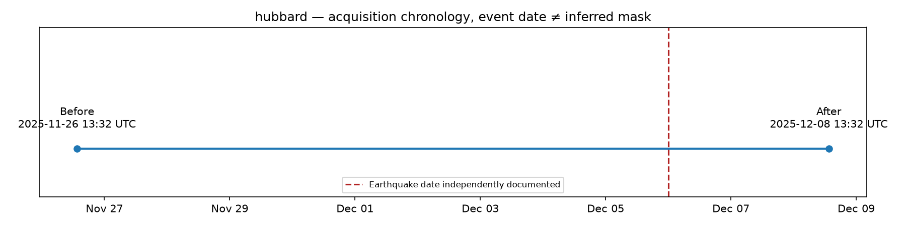
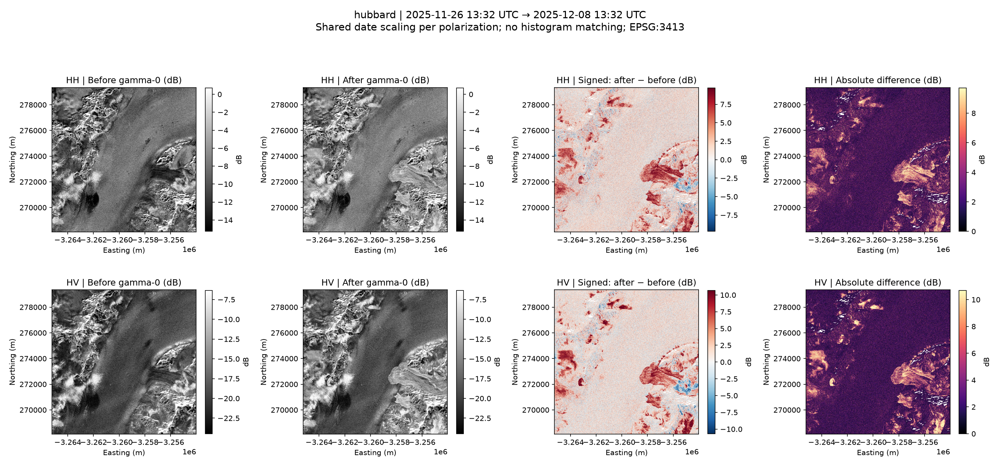
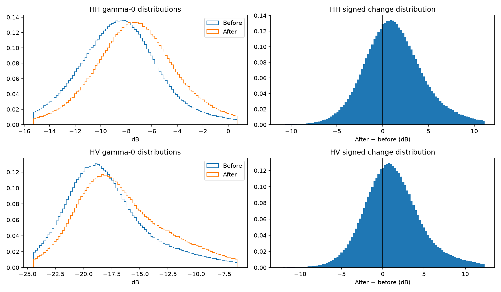
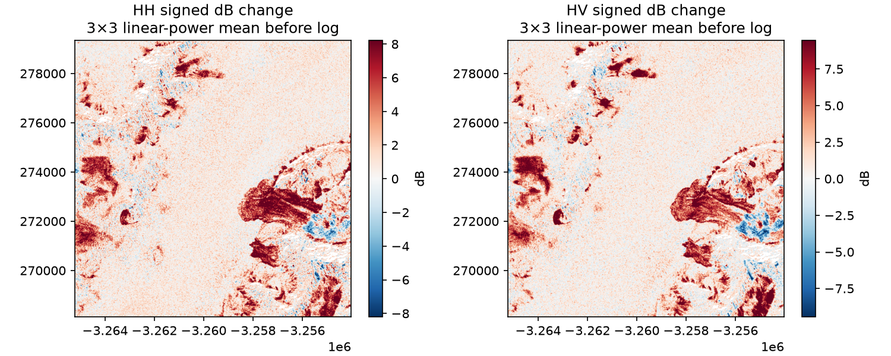

# hubbard: before/after NISAR EDA

Before: **2025-11-26 13:32:27 UTC**. After: **2025-12-08 13:32:28 UTC**.

Event context: [Earthquake date independently documented](https://science.nasa.gov/earth/earth-observatory/landslide-and-avalanche-debris-litter-hubbard-glacier/).

November 26/December 8 bracket the earthquake. Snow, ice motion and terrain can mimic deposit-related backscatter change; Beta data.

Proposed bbox `[west,south,east,north]`: `[-139.89107282236728, 60.40508444125045, -139.70892717763275, 60.494915558749554]`. Common valid pixels: 99.23%. Frequency A; EPSG:3413.

These are measured polarization-intensity comparisons, not RGB photographs or validated event masks. Each polarization uses exactly the same dB display limits at both dates. Red signed differences mean stronger post-event returns; blue means weaker. Both signs can represent change.

The filtered figure averages 3×3 linear-power neighborhoods before taking logarithms; it is an EDA sensitivity check, not a hidden change to model inputs.

Statistics and chronology checks: [eda.json](eda.json). No accuracy metric or calibrated change probability is inferred from these figures.
