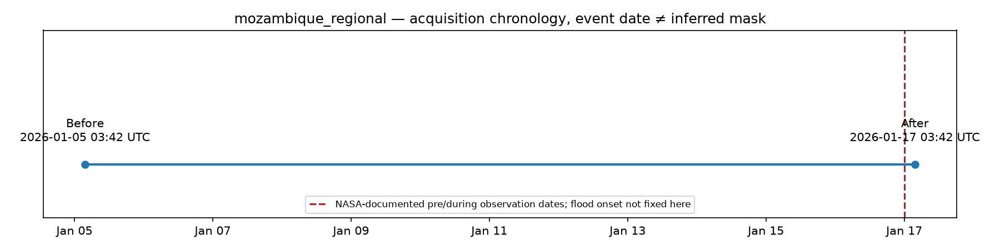
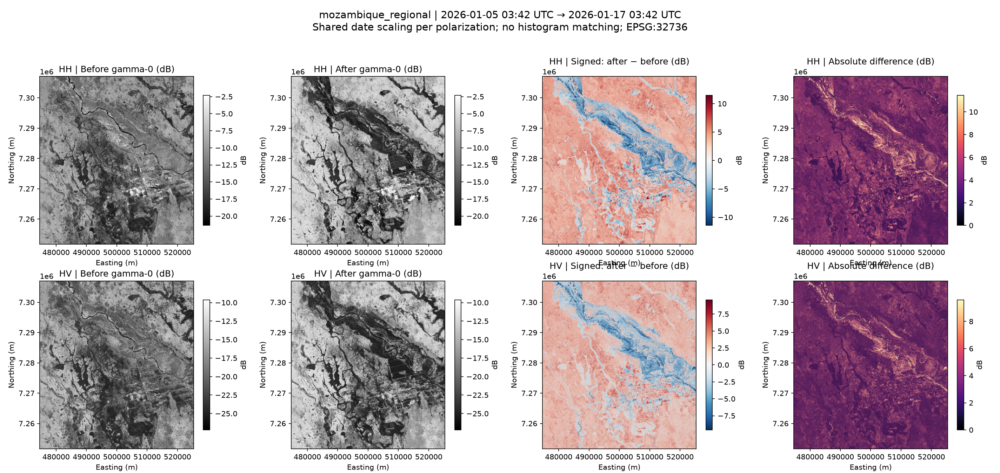
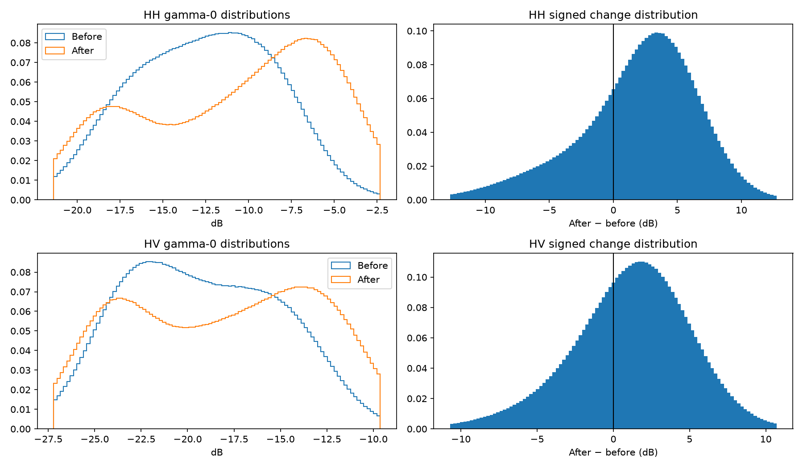
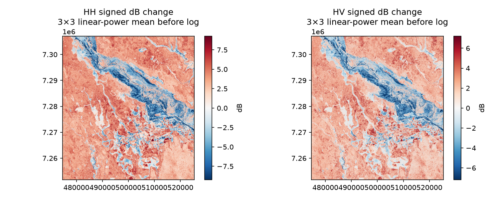
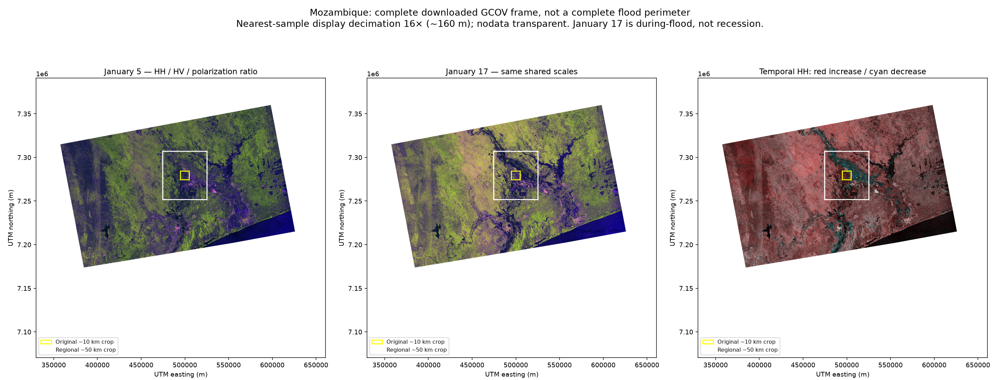

# mozambique_regional: before/after NISAR EDA

Before: **2026-01-05 03:42:32 UTC**. After: **2026-01-17 03:42:32 UTC**.

Event context: [NASA-documented pre/during observation dates; flood onset not fixed here](https://svs.gsfc.nasa.gov/5661).

NASA compares January 5 and January 17. Flooding developed over a longer rainfall interval: January 5 is the comparison image, not proven entirely pre-flood. January 17 is a during-flood acquisition; Beta calibration caveats apply. This is a wider geographic context crop; it does not establish the complete flood extent.

Proposed bbox `[west,south,east,north]`: `[32.75, -24.85, 33.25, -24.35]`. Common valid pixels: 100.00%. Frequency A; EPSG:32736.

These are measured polarization-intensity comparisons, not RGB photographs or validated event masks. Each polarization uses exactly the same dB display limits at both dates. Red signed differences mean stronger post-event returns; blue means weaker. Both signs can represent change.

The filtered figure averages 3×3 linear-power neighborhoods before taking logarithms; it is an EDA sensitivity check, not a hidden change to model inputs.

Statistics and chronology checks: [eda.json](eda.json). No accuracy metric or calibrated change probability is inferred from these figures.

## Full downloaded acquisition context

Yellow outlines the original crop; white outlines the wider regional crop. This view shows the complete downloaded frame using nearest-sample decimation for display. It is not a mapped flood perimeter, and floodwater may extend outside the acquisition footprint. Polarization-composite colors describe scattering; temporal red/cyan indicates relative increases/decreases, not a flood class.
