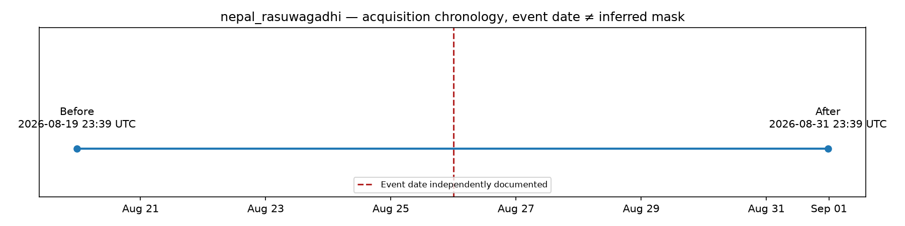
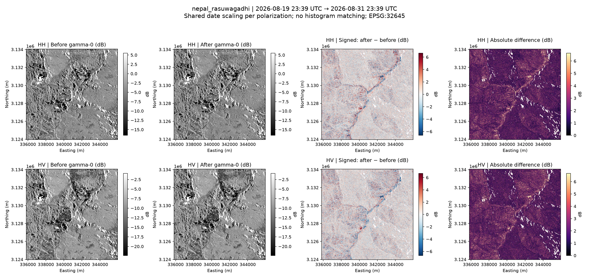
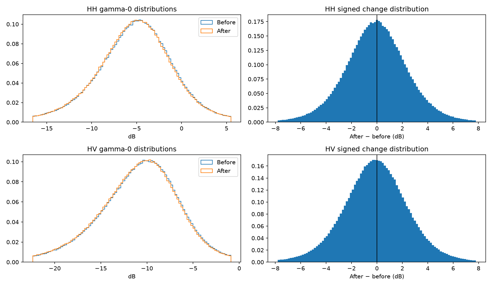
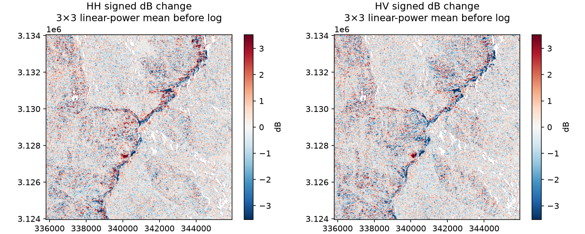

# nepal_rasuwagadhi: before/after NISAR EDA

Before: **2026-08-19 23:39:18 UTC**. After: **2026-08-31 23:39:18 UTC**.

Event context: [Event date independently documented](https://sentinel-asia.org/EO/2026/article20260826NP.html).

Box covers a settlement/river corridor, not the verified source failure. Flood changes and terrain artifacts must be distinguished.

Proposed bbox `[west,south,east,north]`: `[85.32667662532783, 28.232498771250448, 85.42868045467218, 28.32232988874955]`. Common valid pixels: 97.91%. Frequency A; EPSG:32645.

These are measured polarization-intensity comparisons, not RGB photographs or validated event masks. Each polarization uses exactly the same dB display limits at both dates. Red signed differences mean stronger post-event returns; blue means weaker. Both signs can represent change.

The filtered figure averages 3×3 linear-power neighborhoods before taking logarithms; it is an EDA sensitivity check, not a hidden change to model inputs.

Statistics and chronology checks: [eda.json](eda.json). No accuracy metric or calibrated change probability is inferred from these figures.
