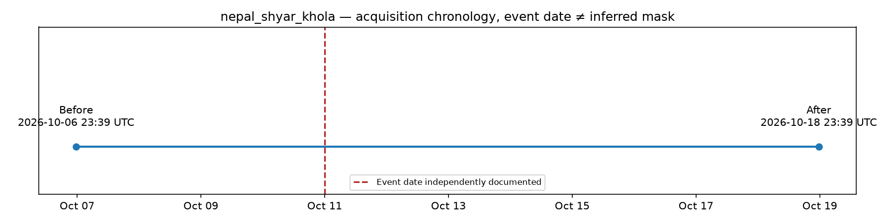
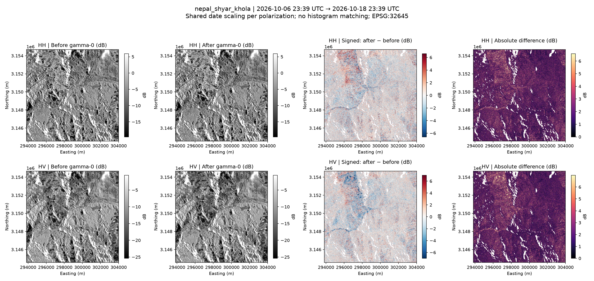
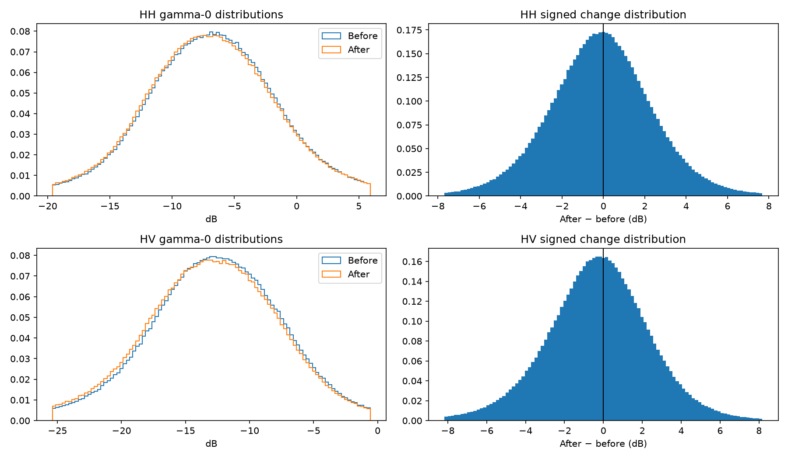
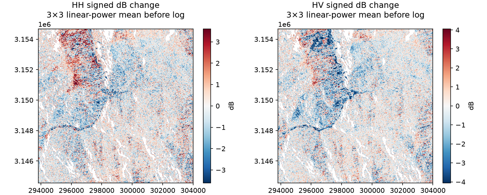

# nepal_shyar_khola: before/after NISAR EDA

Before: **2026-10-06 23:39:18 UTC**. After: **2026-10-18 23:39:18 UTC**.

Event context: [Event date independently documented](https://eu-space.europa.eu/components/earth-observation-copernicus/image-of-the-day/landslide-triggered-flash-flood-sweeps-through-nepals-himalayan-valleys).

October 11 avalanche/debris-flow/flood cascade. River deposits, snow and terrain can produce different radar signatures.

Proposed bbox `[west,south,east,north]`: `[84.89520137143788, 28.41275444125045, 84.99737862856213, 28.50258555874955]`. Common valid pixels: 94.72%. Frequency A; EPSG:32645.

These are measured polarization-intensity comparisons, not RGB photographs or validated event masks. Each polarization uses exactly the same dB display limits at both dates. Red signed differences mean stronger post-event returns; blue means weaker. Both signs can represent change.

The filtered figure averages 3×3 linear-power neighborhoods before taking logarithms; it is an EDA sensitivity check, not a hidden change to model inputs.

Statistics and chronology checks: [eda.json](eda.json). No accuracy metric or calibrated change probability is inferred from these figures.
