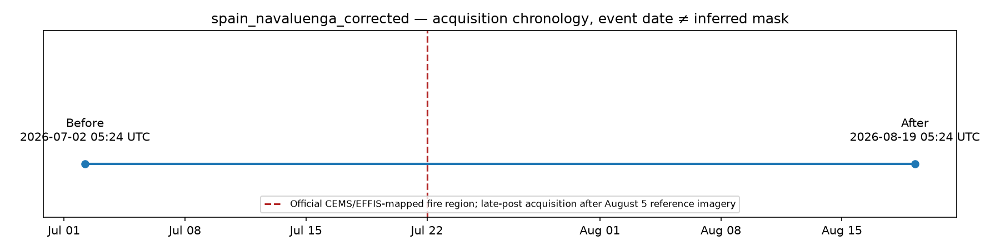
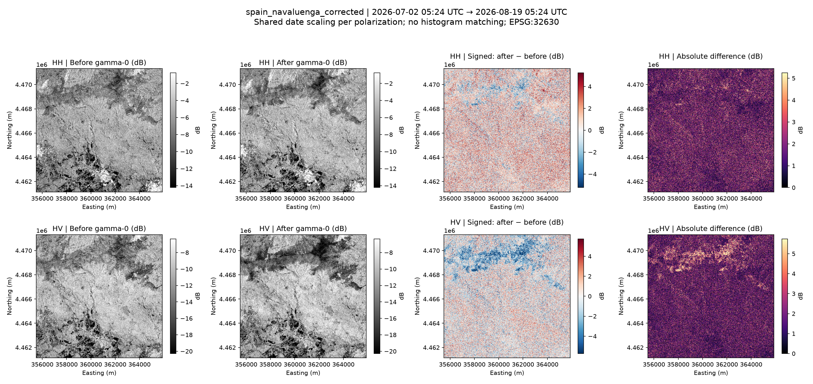
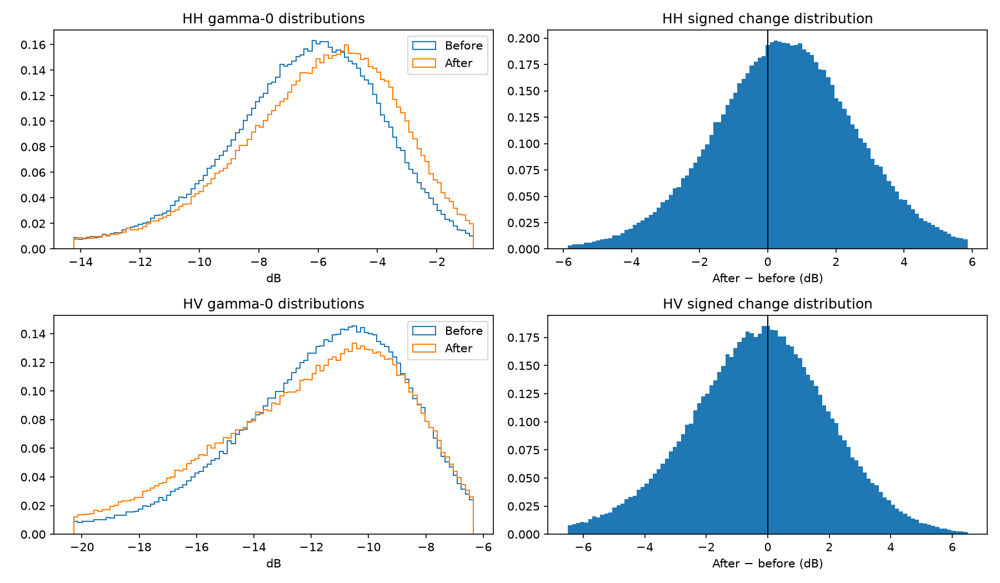
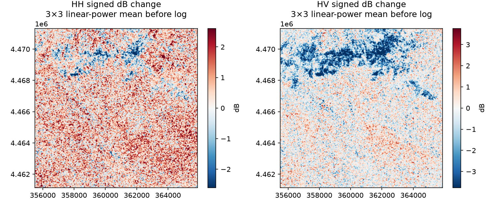
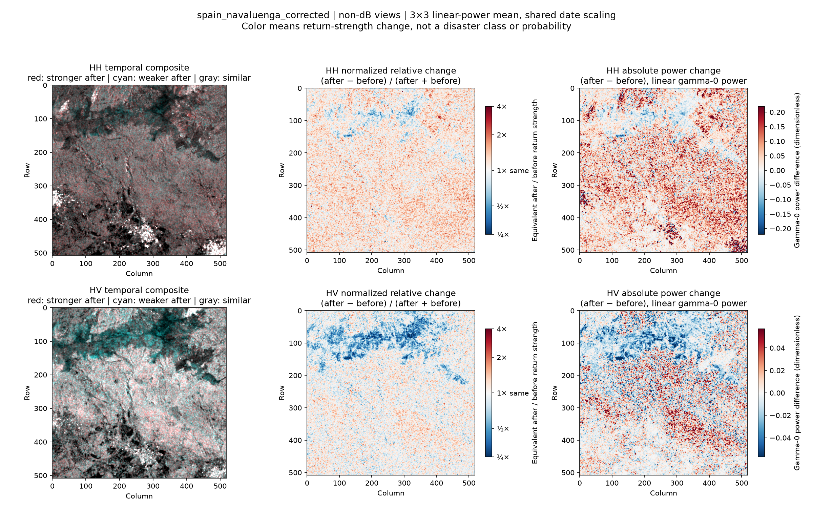
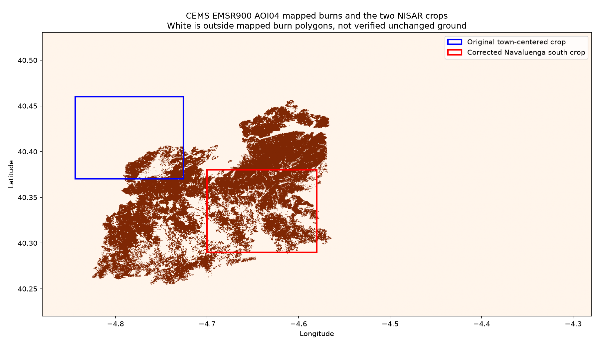
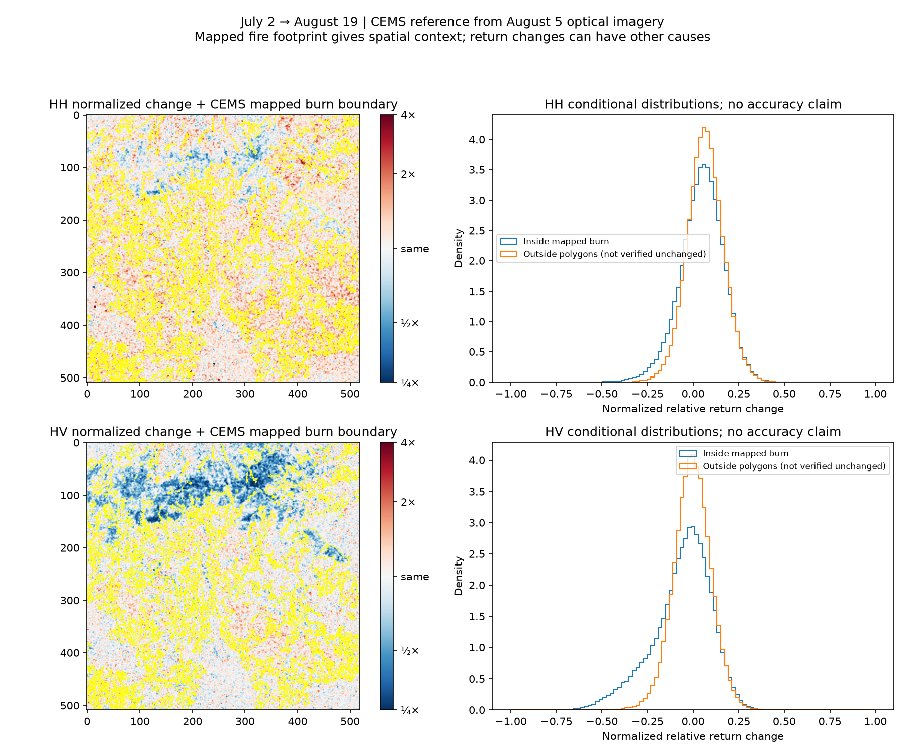

# spain_navaluenga_corrected: before/after NISAR EDA

Before: **2026-07-02 05:24:02 UTC**. After: **2026-08-19 05:24:00 UTC**.

Event context: [Official CEMS/EFFIS-mapped fire region; late-post acquisition after August 5 reference imagery](https://mapping.emergency.copernicus.eu/activations/EMSR900/).

Corrected Navaluenga south AOI selected with independently mapped fire geometry, not just the town name. July 2/August 19 use same track/frame/CRID and near-real-time orbit class. The longer interval also includes non-fire seasonal/moisture changes. CEMS August 5 optical-derived burn polygons are contextual references, not exhaustive generic-change labels.

Proposed bbox `[west,south,east,north]`: `[-4.7, 40.29, -4.58, 40.38]`. Common valid pixels: 100.00%. Frequency A; EPSG:32630.

These are measured polarization-intensity comparisons, not RGB photographs or validated event masks. Each polarization uses exactly the same dB display limits at both dates. Red signed differences mean stronger post-event returns; blue means weaker. Both signs can represent change.

The filtered figure averages 3×3 linear-power neighborhoods before taking logarithms; it is an EDA sensitivity check, not a hidden change to model inputs.

Statistics and chronology checks: [eda.json](eda.json). No accuracy metric or calibrated change probability is inferred from these figures.

## Non-dB companion views

These use a 3×3 mean of linear power before comparison; model inputs and prior results are unchanged. Relative-map ticks show fold change: ½× means half the pre-image return; 2× means twice. The score is bounded, not a probability. Very dark pixels remain susceptible to relative-change noise. Linear-change GeoTIFFs retain the full unclipped values. Red/cyan are explicitly assigned and must not be interpreted as fire/flood labels.

[Numerical display metadata](non_db_metadata.json). Method rationale: [ASF SAR scale guide](https://hyp3-docs.asf.alaska.edu/hyp3-docs/guides/introduction_to_sar/) and [ESA-supported SAR temporal-composite service](https://docs.mcube.terradue.com/services/sar-change/service-specs/). Our red/cyan assignment is post/pre, and is the reverse of services that assign pre-image to red.

## Independent mapped-fire context

Yellow outlines are CEMS optical-derived burn polygons from August 5 imagery. They provide independent context; outside polygons are not verified unchanged. See [reference comparison](reference_comparison.json).
