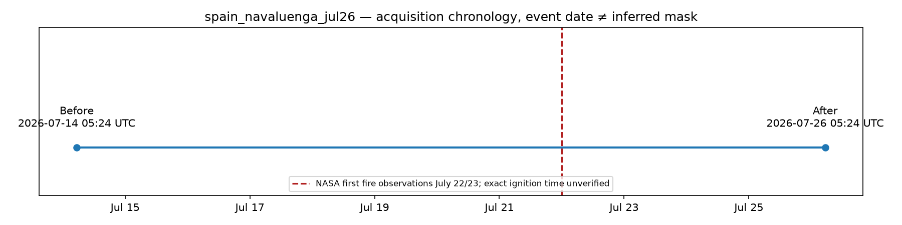
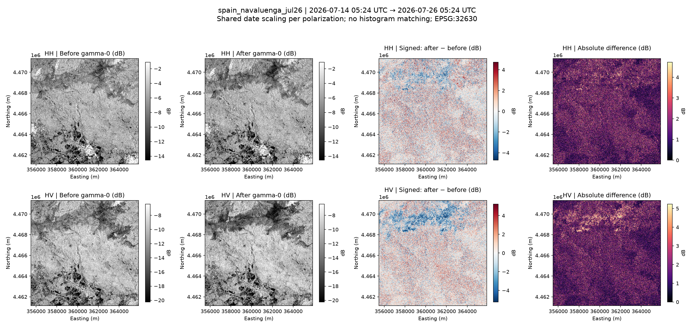
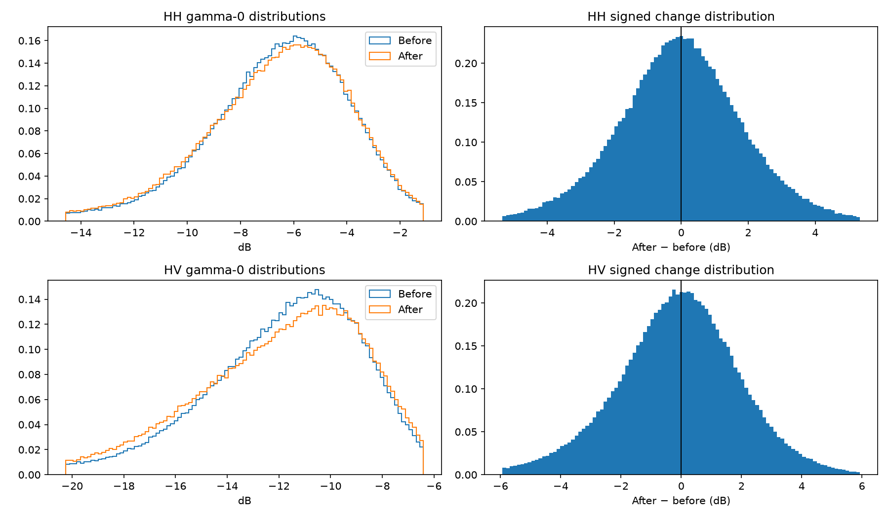
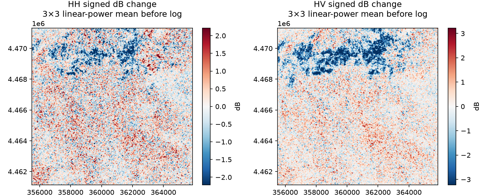

# spain_navaluenga_jul26: before/after NISAR EDA

Before: **2026-07-14 05:24:01 UTC**. After: **2026-07-26 05:24:01 UTC**.

Event context: [NASA first fire observations July 22/23; exact ignition time unverified](https://science.nasa.gov/earth/earth-observatory/destructive-fires-char-western-europe/).

Corrected AOI selected using official EFFIS fire polygons; July 26 remains a during-fire observation. Original town box retained for comparison.

Proposed bbox `[west,south,east,north]`: `[-4.7, 40.29, -4.58, 40.38]`. Common valid pixels: 100.00%. Frequency A; EPSG:32630.

These are measured polarization-intensity comparisons, not RGB photographs or validated event masks. Each polarization uses exactly the same dB display limits at both dates. Red signed differences mean stronger post-event returns; blue means weaker. Both signs can represent change.

The filtered figure averages 3×3 linear-power neighborhoods before taking logarithms; it is an EDA sensitivity check, not a hidden change to model inputs.

Statistics and chronology checks: [eda.json](eda.json). No accuracy metric or calibrated change probability is inferred from these figures.
