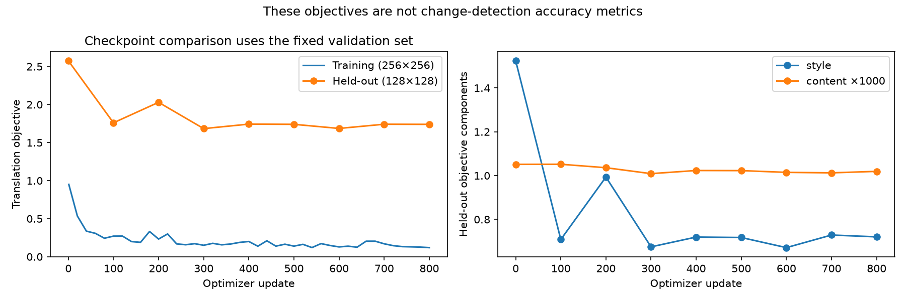
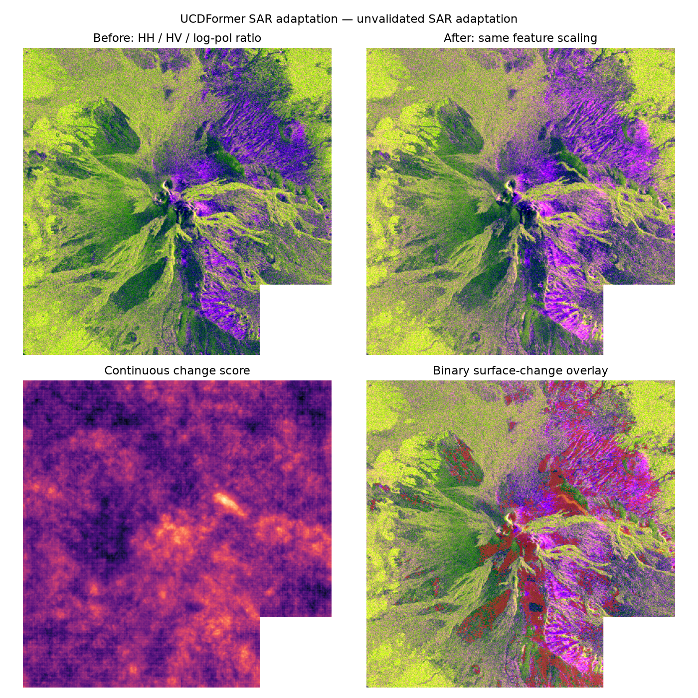
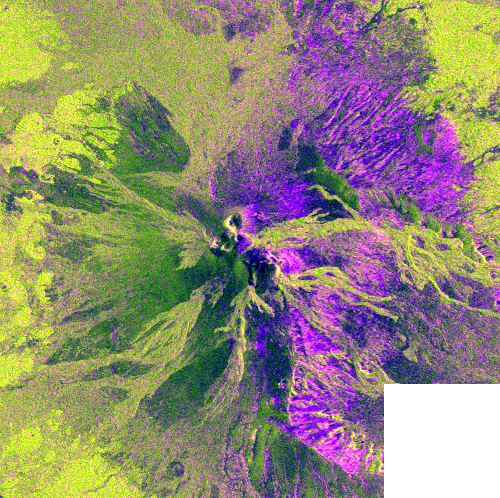
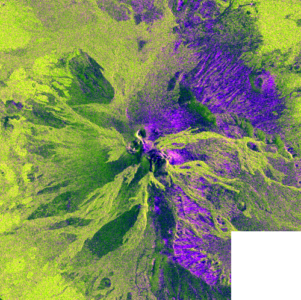
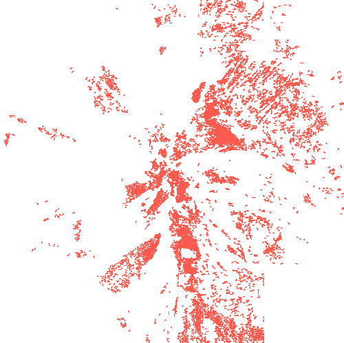
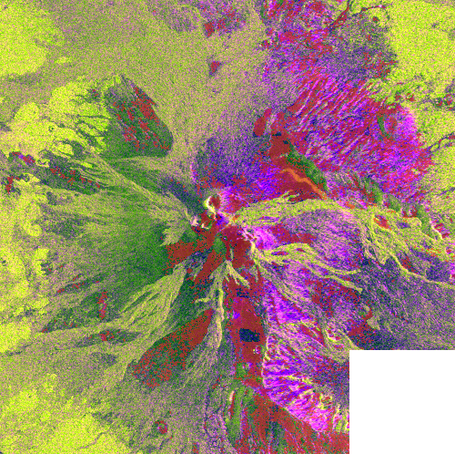
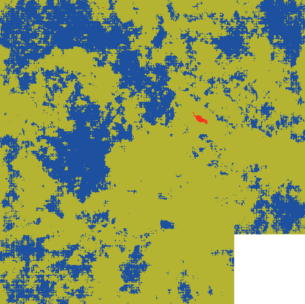

# Etna: first executed UCDFormer SAR adaptation

Inputs: July 23 and August 16, 2026; HH/HV GCOV, 20 m UTM zone 33N. Approximately 10×10 km around the summit. See [per-polarization EDA](../../../outputs/eda/etna/README.md) for physical changes and event chronology.

## What ran

Three named features (HH dB, HV dB, their dB difference), shared training-strip scaling, original optical VGG/StyleFormer/decoder initialization, scene-pair translation adaptation, VGG feature differences, strict FCM/adaptive pseudo-label agreement and final RF classification. Checkpoint initialization loaded strictly with no translator/decoder tensor mismatch. Raw-dot content affinity follows actual repository code, despite its cosine naming; near-zero denominators are guarded. Gradient norm clipped at 100.

Training stopped at 800 updates; selected update 300. Held-out translation objective: 2.5755 initially → 1.6838 best. This is not detection accuracy. Five overlapping training windows are drawn from the northern strip; three 128-pixel validation windows lie in the southern strip, separated by a 114-pixel moat. Training and validation patch fields of view differ, so their losses should not be compared as equal-scale generalization error. Checkpoints are compared on the same validation windows.

## Results and practical limits

Model-supported coverage: 94.69%. Changed fraction of that supported coverage: 12.08%. These are algorithm outputs, not verified event extent.

The conservative model path accepts fully valid inference tiles. One invalid native pixel at row 464/column 442 excludes a larger bottom-right tile region, leaving about 5.3% unsupported; white/transparent areas are nodata, not unchanged. Full physical EDA still covers all valid native pixels. Resolving that unsupported area requires a reviewed inference-context/mask strategy.

Only 160 confident changed seeds trained the RF against balanced unchanged samples. The RF extrapolates beyond those seeds; this needs independent inspection. The output also flags broad terrain/texture-related areas. It is a prototype, not a validated lava or damage map. Translation did not eliminate every nuisance change. A no-translation result and a physical Otsu baseline are saved for comparison.

No independent reference labels were available; no F1, IoU or accuracy is claimed. Before/after chronology establishes an observation interval, not that every flagged pixel was caused by volcanic activity.

## Files for the app

- [study.json](study.json): method, sources, geographic bounds, valid/changed area and limitations.
- [Binary GeoTIFF](change_mask.tif): 0 unchanged, 1 changed, 255 nodata; native projected CRS.
- [Continuous score](change_score.tif): raw uncalibrated feature score.
- `before_wgs84.png`, `after_wgs84.png`, `mask_wgs84.png`, `overlay_wgs84.png`: geographic display assets using the bounds in study.json.
- `best.pt`, `random_forest.joblib`, `effective_config.json`, `pair_metadata.json`, `run.jsonl`: initialization, adaptation and output provenance.

New timestamp pairs require their own preprocessing and may need translation/RF adaptation. This run does not establish an instant reusable cross-event model.

WGS84 PNG previews have been refreshed to preserve native image proportions, using non-square degree pixels. Use the updated bounds and display transform in study.json for geographic placement. Native mask.png is unchanged.

## Image gallery

**after.png** — After acquisition: the same feature scaling as before for visual comparison.

**after_wgs84.png** — After acquisition: the same feature scaling as before for visual comparison. Geographic WGS84 export of the same result; use the bounds and display transform in study.json for map placement.

**before.png** — Before acquisition: shared-scale HH / HV / log-polarization-ratio SAR composite.

**before_wgs84.png** — Before acquisition: shared-scale HH / HV / log-polarization-ratio SAR composite. Geographic WGS84 export of the same result; use the bounds and display transform in study.json for map placement.

**mask.png** — Final binary change overlay: red marks detected change; remaining pixels are transparent. Consult valid coverage to distinguish unchanged from unsupported.

**mask_wgs84.png** — Final binary change overlay: red marks detected change; remaining pixels are transparent. Consult valid coverage to distinguish unchanged from unsupported. Geographic WGS84 export of the same result; use the bounds and display transform in study.json for map placement.

**overlay.png** — Final detected-change mask in red over the after-acquisition composite.

**overlay_wgs84.png** — Final detected-change mask in red over the after-acquisition composite. Geographic WGS84 export of the same result; use the bounds and display transform in study.json for map placement.

**pseudo_labels.png** — Automatically generated seed labels: red changed, blue unchanged, yellow uncertain. These are not ground-truth labels or the final mask.

