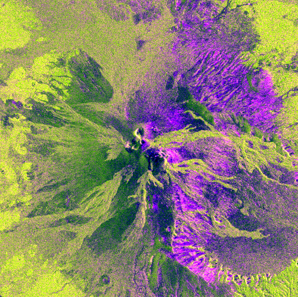
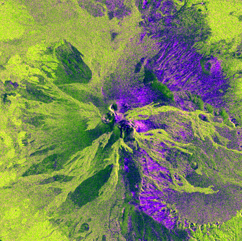
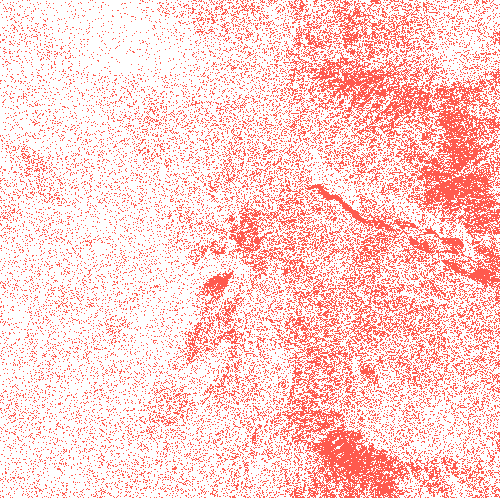
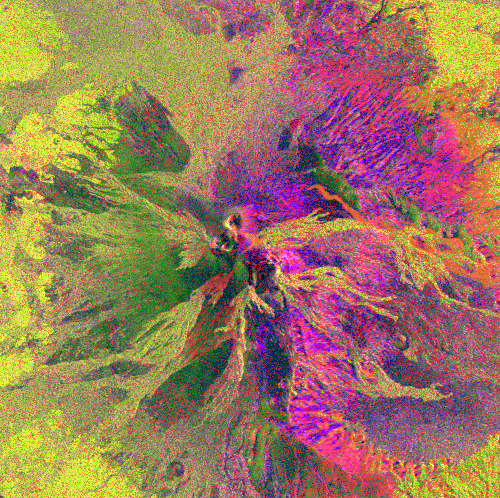
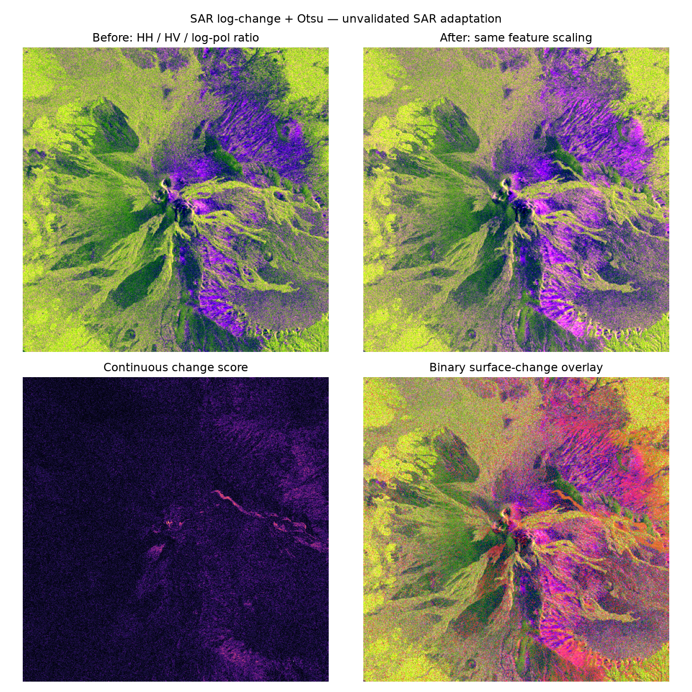
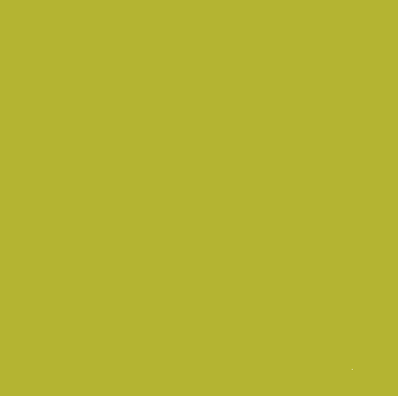

# baseline

Native mask.png: final red change overlay; overlay.png: mask over after image; before.png and after.png: shared-scale SAR composites; pseudo_labels.png: seed labels, not final predictions.

WGS84 PNG previews have been refreshed to preserve native image proportions, using non-square degree pixels. Use the updated bounds and display transform in study.json for geographic placement. Native mask.png is unchanged.

## Image gallery

**after.png** — After acquisition: the same feature scaling as before for visual comparison.

**after_wgs84.png** — After acquisition: the same feature scaling as before for visual comparison. Geographic WGS84 export of the same result; use the bounds and display transform in study.json for map placement.

**before.png** — Before acquisition: shared-scale HH / HV / log-polarization-ratio SAR composite.

**before_wgs84.png** — Before acquisition: shared-scale HH / HV / log-polarization-ratio SAR composite. Geographic WGS84 export of the same result; use the bounds and display transform in study.json for map placement.

**mask.png** — Final binary change overlay: red marks detected change; remaining pixels are transparent. Consult valid coverage to distinguish unchanged from unsupported.

**mask_wgs84.png** — Final binary change overlay: red marks detected change; remaining pixels are transparent. Consult valid coverage to distinguish unchanged from unsupported. Geographic WGS84 export of the same result; use the bounds and display transform in study.json for map placement.

**overlay.png** — Final detected-change mask in red over the after-acquisition composite.

**overlay_wgs84.png** — Final detected-change mask in red over the after-acquisition composite. Geographic WGS84 export of the same result; use the bounds and display transform in study.json for map placement.

**overview.png** — Both acquisitions, continuous change score and final detected-change overlay.

**pseudo_labels.png** — Automatically generated seed labels: red changed, blue unchanged, yellow uncertain. These are not ground-truth labels or the final mask.

