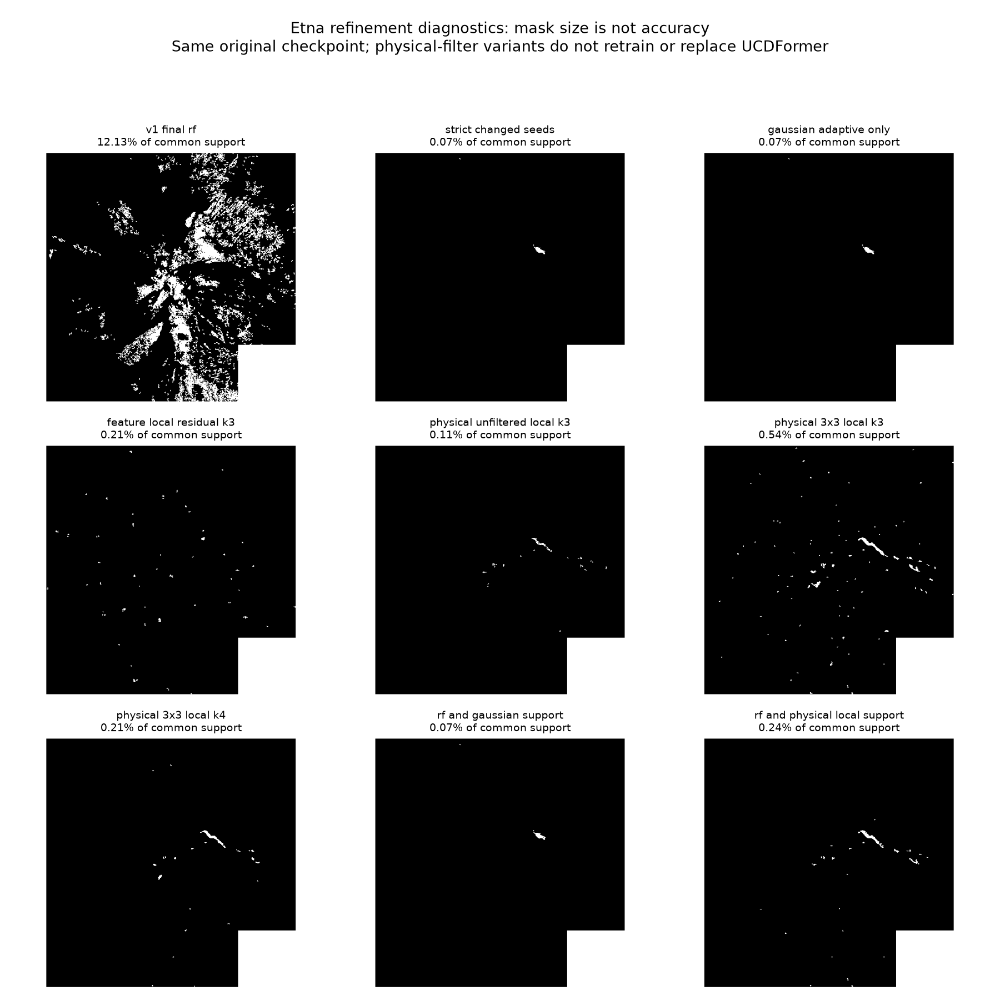

# Etna threshold and denoising ablations

These diagnostics preserve v1 outputs and the trained checkpoint. The original RF expands 160 confident positive seeds to 28397 changed pixels. That expansion, feature-domain mismatch and terrain shifts are plausible causes of broad detections; speckle is not the only hypothesis.

No variant is designated the most accurate. Smaller maps are not automatically better. Physical variants compare unfiltered and 3×3 linear-power mean inputs using a normalized relative-change score; their local windows span 620 m. The robust threshold uses a local-residual MAD approximation and is not a statistical p-value. The physical score floor 0.1 is a sensitivity parameter, not a learned or validated decision boundary. Maps use the common v1 support so counts can be compared. Raw GeoTIFFs and [parameters/counts](comparison.json) are retained.

RF intersection variants are conservative gates that may reduce false alarms but can also remove genuine changes. A new filtered UCDFormer input pipeline would require consistent re-adaptation, not just these post-hoc maps. Next review the actual event structure, seed geography, registration and residual images before selecting a v2 output. See [literature applicability review](../../../../SAR_DENOISING_REVIEW.md).

An app-ready [conservative candidate](conservative_candidate/study.json) is exported separately with its physical score, gate parameters, mask and geographic overlays. It is explicitly unvalidated and does not replace the original model result or establish the best threshold.
