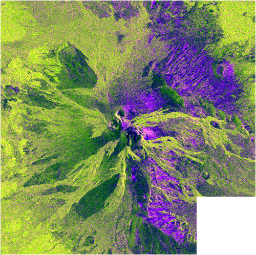
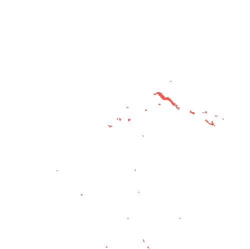
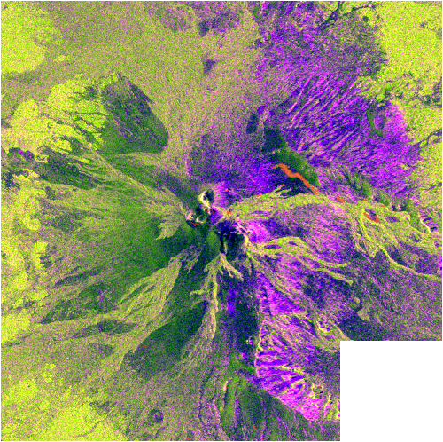
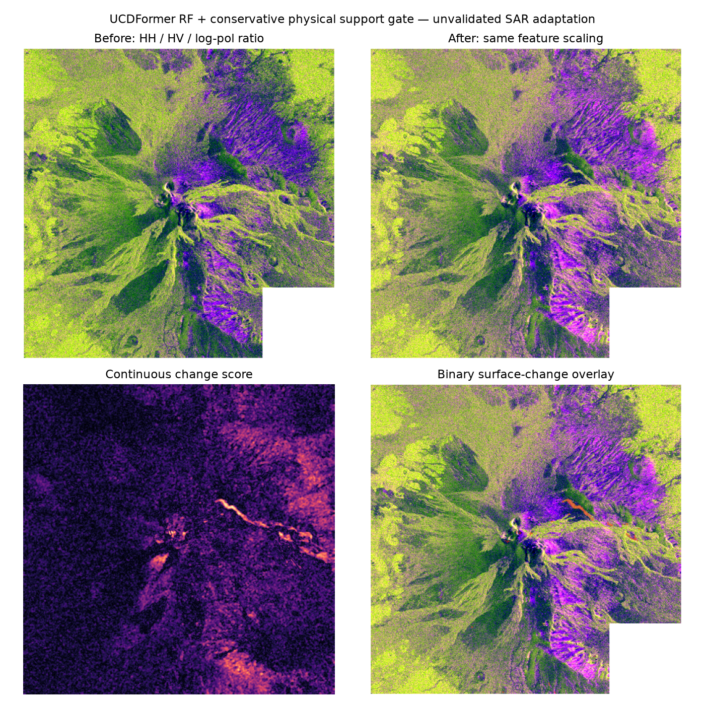
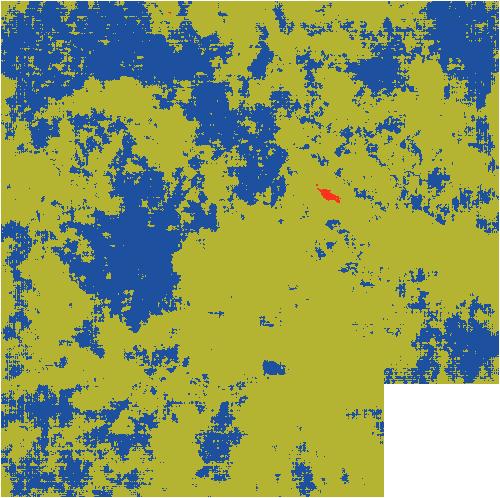

# Preferred Etna display candidate

The user identified `mask.png` here as the preferred visual result. Selection is based on visual preference, not measured accuracy. The original UCDFormer model was **not retrained** to produce this candidate.

- `mask.png`: native-grid RGBA overlay. Red means flagged change; all other pixels are transparent. Both unchanged and unsupported pixels are transparent, so this display alone does not distinguish them.
- `overlay.png`: that mask blended over the after-image feature composite.
- `mask_wgs84.png` / `overlay_wgs84.png`: geographic versions for web-map placement using the bounds in `study.json`.
- `change_mask.tif`: scientific mask, with 0 unchanged, 1 flagged change, and 255 nodata. `valid_mask.tif` records supported coverage.
- `pseudo_labels.png`: **original v1 training seeds**, retained as context. It is not this final conservative mask and was not regenerated/retrained for this candidate. Changed seeds are orange/red, unchanged seeds blue, uncertain pixels yellow/olive, invalid transparent.

The gate is: original UCDFormer/RF says change **AND** the 3×3 linear-power physical change score exceeds its robust local threshold, with a relative-score floor. This marks **560 pixels**, or **0.224 km²** at 20 m spacing, about **0.239%** of the common supported area. The method can omit true changes; the area is an algorithm output, not verified volcanic extent.

The new end-to-end rerun is saved separately under `outputs/etna_v2/`. Its pseudo-labels and classifier are different and do not replace this preferred mask automatically.

WGS84 PNG previews have been refreshed to preserve native image proportions, using non-square degree pixels. Use the updated bounds and display transform in study.json for geographic placement. Native mask.png is unchanged.

## Image gallery

**after.png** — After acquisition: the same feature scaling as before for visual comparison.

**after_wgs84.png** — After acquisition: the same feature scaling as before for visual comparison. Geographic WGS84 export of the same result; use the bounds and display transform in study.json for map placement.

**before.png** — Before acquisition: shared-scale HH / HV / log-polarization-ratio SAR composite.

**before_wgs84.png** — Before acquisition: shared-scale HH / HV / log-polarization-ratio SAR composite. Geographic WGS84 export of the same result; use the bounds and display transform in study.json for map placement.

**mask.png** — Final binary change overlay: red marks detected change; remaining pixels are transparent. Consult valid coverage to distinguish unchanged from unsupported.

**mask_wgs84.png** — Final binary change overlay: red marks detected change; remaining pixels are transparent. Consult valid coverage to distinguish unchanged from unsupported. Geographic WGS84 export of the same result; use the bounds and display transform in study.json for map placement.

**overlay.png** — Final detected-change mask in red over the after-acquisition composite.

**overlay_wgs84.png** — Final detected-change mask in red over the after-acquisition composite. Geographic WGS84 export of the same result; use the bounds and display transform in study.json for map placement.

**overview.png** — Both acquisitions, continuous change score and final detected-change overlay.

**pseudo_labels.png** — Automatically generated seed labels: red changed, blue unchanged, yellow uncertain. These are not ground-truth labels or the final mask.

