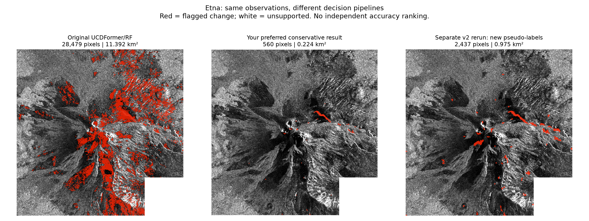
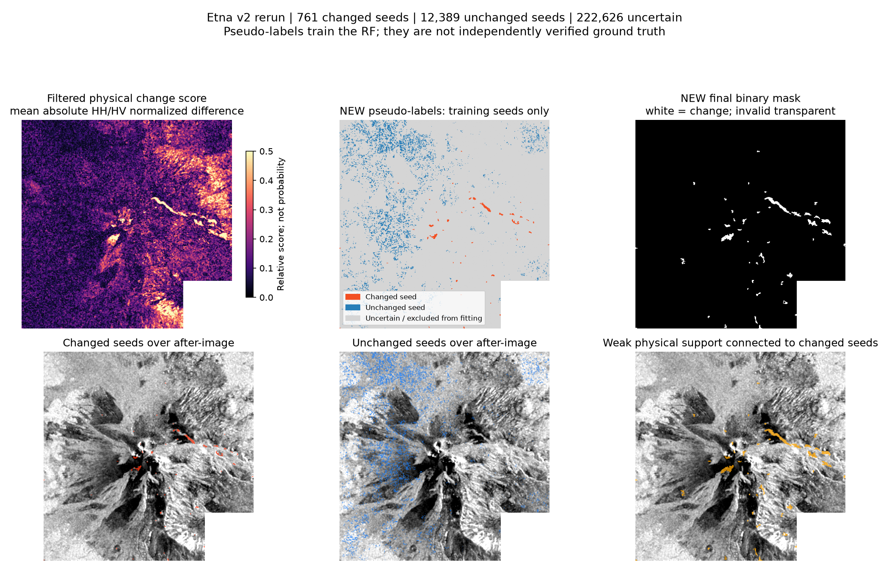
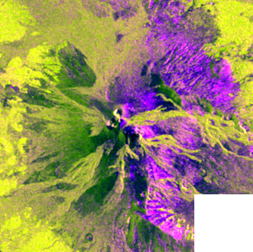
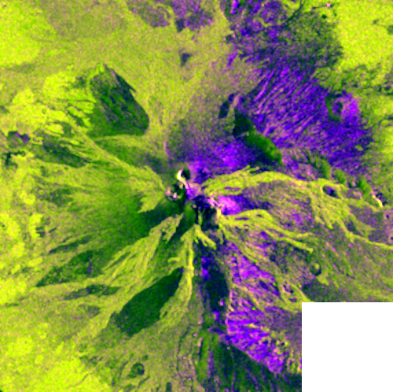
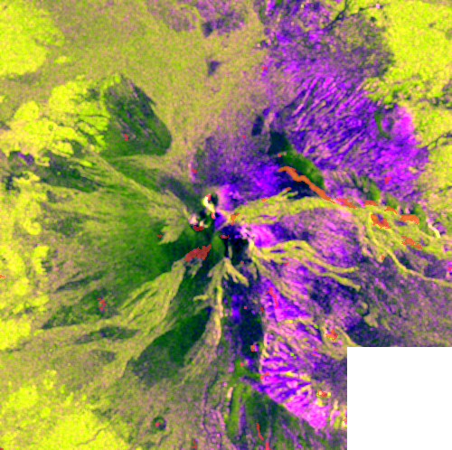
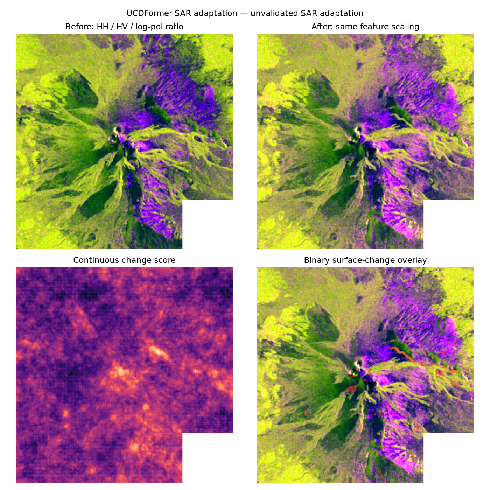
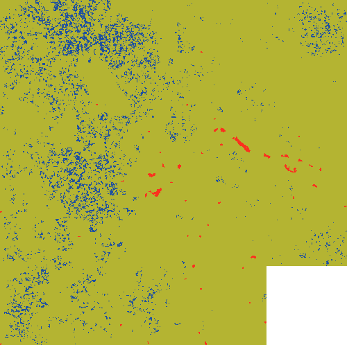

# Etna v2: separate end-to-end rerun

The preferred display result remains [the conservative v1 mask](../etna/refinement/conservative_candidate/mask.png). This experiment does not replace it. Selection of the preferred mask reflects the user's visual preference, not measured accuracy.

## What changed

Applied a shared 3×3 masked mean to linear power at both dates before feature construction; incomplete interior support stays invalid and crop-edge reflection is recorded. Re-adapted the original pretrained translator/decoder with the same held-out spatial split, then regenerated all feature scores and pseudo-labels.

New changed seeds require strong physical normalized change, a local robust threshold and high FCM membership in the feature-score high cluster. Unchanged seeds require small physical change and high low-cluster membership. Everything else remains uncertain. New RF descriptors include explicit temporal differences and signed per-polarization normalized change. Uncertain positives require a vote fraction at least 0.8 plus weak physical support connected to a positive seed. Memberships/votes are not calibrated probabilities. This is an explicit UCDFormer extension, not exact paper reproduction.

## Executed result

- Training: 600 updates; selected update 100 by held-out translation objective. Objective 2.7843 → 1.7698; this is not change-detection accuracy and is not directly comparable to the differently preprocessed v1 objective.
- New seeds: 761 changed, 12,389 unchanged, 222,626 uncertain.
- Final mask: 2,437 pixels, 0.9748 km²; 1.03% of model support.
- Model support: 94.69%. Unsupported tiles near the native invalid samples remain nodata. No independent accuracy established.

## Pseudo-labels versus final output

Pseudo-labels are only the selected examples used to fit the final RF. Gray in the review figure means uncertain/excluded from fitting, not unchanged or changed. Red/orange and blue are changed/unchanged training examples. The final binary output is shown separately.

- [Final mask overlay](mask.png) and [after-image overlay](overlay.png).
- [Grayscale binary display](binary_mask_grayscale.png): black unchanged, white flagged, gray unsupported.
- [Scientific GeoTIFF](change_mask.tif): 0/1/255 nodata.
- [study.json](study.json) and [effective config](effective_config.json) record the method and parameters.
- Physical teacher score, local thresholds, FCM changed membership, connected support and RF votes are exported as separate diagnostic GeoTIFFs. None is ground truth.

The previous conservative mask covers 0.224 km²; this rerun covers about 0.975 km². A larger/smaller mask is not automatically better. Both are retained for review; the preferred selection still points to the conservative result.

WGS84 PNG previews have been refreshed to preserve native image proportions, using non-square degree pixels. Use the updated bounds and display transform in study.json for geographic placement. Native mask.png is unchanged.

## Image gallery

**after.png** — After acquisition: the same feature scaling as before for visual comparison.

**after_wgs84.png** — After acquisition: the same feature scaling as before for visual comparison. Geographic WGS84 export of the same result; use the bounds and display transform in study.json for map placement.

**before.png** — Before acquisition: shared-scale HH / HV / log-polarization-ratio SAR composite.

**before_wgs84.png** — Before acquisition: shared-scale HH / HV / log-polarization-ratio SAR composite. Geographic WGS84 export of the same result; use the bounds and display transform in study.json for map placement.

**mask_wgs84.png** — Final binary change overlay: red marks detected change; remaining pixels are transparent. Consult valid coverage to distinguish unchanged from unsupported. Geographic WGS84 export of the same result; use the bounds and display transform in study.json for map placement.

**overlay_wgs84.png** — Final detected-change mask in red over the after-acquisition composite. Geographic WGS84 export of the same result; use the bounds and display transform in study.json for map placement.

**overview.png** — Both acquisitions, continuous change score and final detected-change overlay.

**pseudo_labels.png** — Automatically generated seed labels: red changed, blue unchanged, yellow uncertain. These are not ground-truth labels or the final mask.

