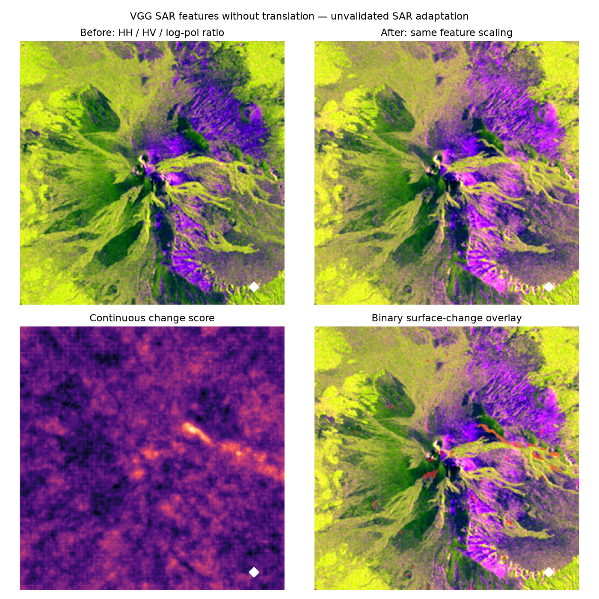
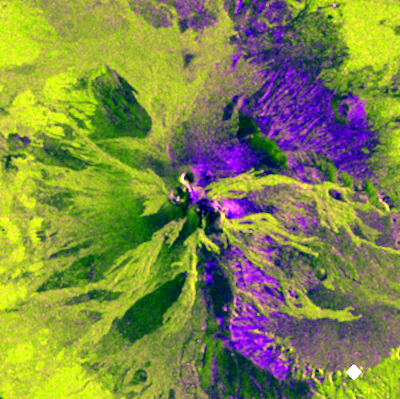
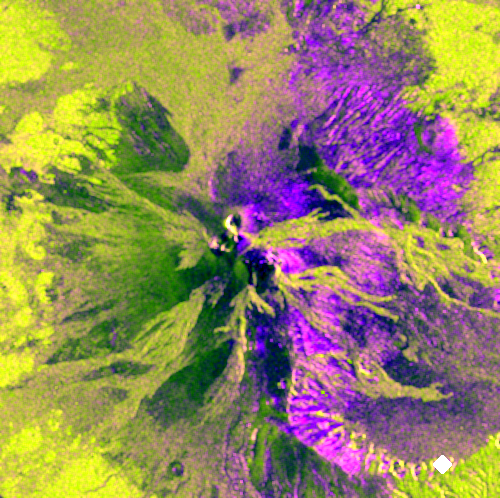
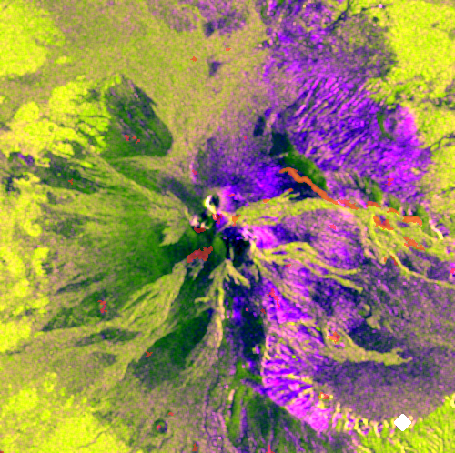
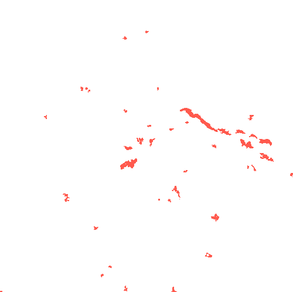
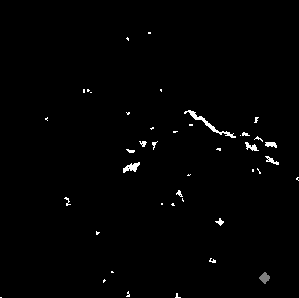
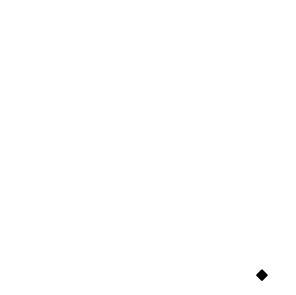
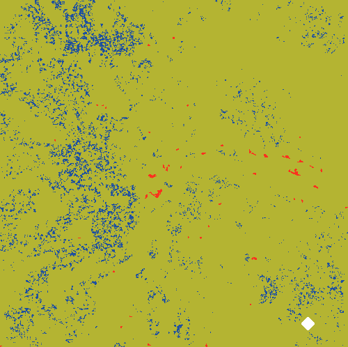

# VGG SAR features without translation

Start with `overview.png` or `overlay.png` (native projected geometry).

| File | Meaning |
|---|---|
| before.png / after.png | Shared-scale HH / HV / log polarization-ratio false-color composites; not optical photos. |
| mask.png | Final binary change mask as a transparent red overlay; not pseudo-labels. |
| binary_mask_grayscale.png | White: changed; black: unchanged; gray: unsupported. |
| overlay.png | Final mask over the after composite. |
| valid_coverage.png | White: scored; black: unsupported. |
| pseudo_labels.png | Training seeds: red changed, blue unchanged, yellow uncertain. |
| *_wgs84.png | Reprojected geographic overlays; use bounds in study.json. Native aspect preserved using non-square degree pixels. |
| change_mask.tif | Georeferenced scientific mask: 0 unchanged, 1 changed, 255 nodata. |
| change_score.tif | Continuous feature score, not a probability. |
| study.json | Dates, CRS, bounds, area, algorithm and limitations. |
| baseline/ | Physical difference plus threshold; no neural model. |
| no_translation/ | Frozen VGG feature comparison, without trained translator. |

This mask uses frozen VGG features with physical gating and a pseudo-label-trained random forest; the trained translator is not applied. Accuracy is unvalidated.

## Images

Overview of both acquisitions, continuous score and final overlay.

Before: shared-scale HH / HV / log polarization-ratio SAR composite.

After: same channels and scaling as before.

Final detected change in red over the after acquisition.

Final binary overlay: red changed; otherwise transparent.

White changed, black unchanged, gray unsupported.

White scored; black unsupported.

Automatic seed labels: red changed, blue unchanged, yellow uncertain; not ground truth.

