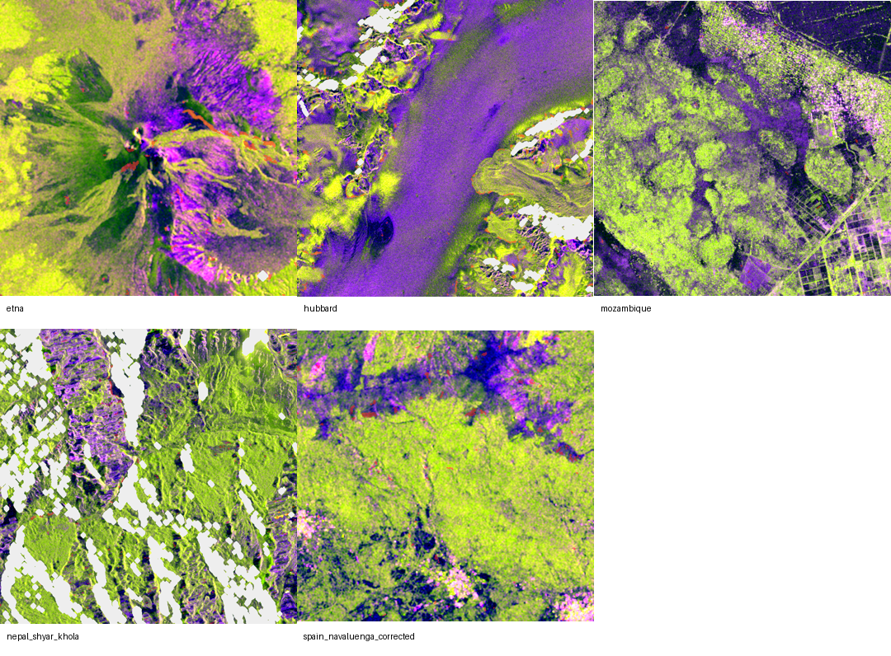

# Location results

Open a location, then `overview.png`, `overlay.png` or `binary_mask_grayscale.png`. Images here retain native projected proportions. Transparent red `mask.png` is intended for overlays.

| Location | Detected change km² | Scored km² |
|---|---:|---:|
| [etna](etna/README.md) | 1.008 | 99.51 |
| [hubbard](hubbard/README.md) | 1.518 | 119.43 |
| [mozambique](mozambique/README.md) | 0.166 | 99.50 |
| [nepal_shyar_khola](nepal_shyar_khola/README.md) | 0.626 | 78.49 |
| [spain_navaluenga_corrected](spain_navaluenga_corrected/README.md) | 0.957 | 105.67 |

Each is a separate pair-specific UCDFormer adaptation, followed by physical gating and pseudo-label random-forest classification. No independent accuracy estimate is available. [Export checks](validation.json) verify geometry, mask values and image links; they do not measure detection accuracy.

Red marks the final detected changes; light gray areas are unsupported. Open individual location READMEs for full resolution and acquisition dates.

