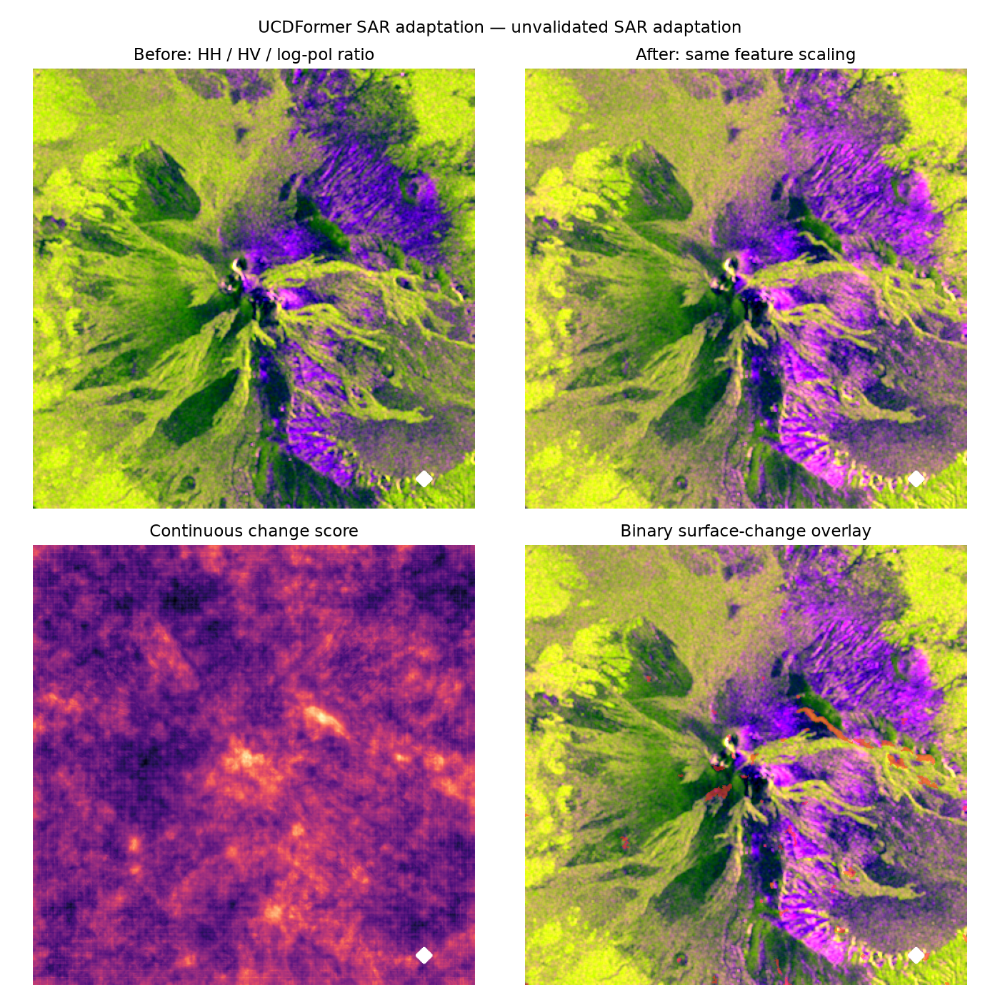
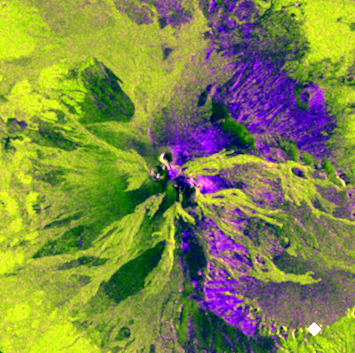
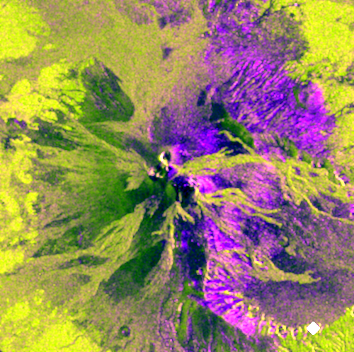
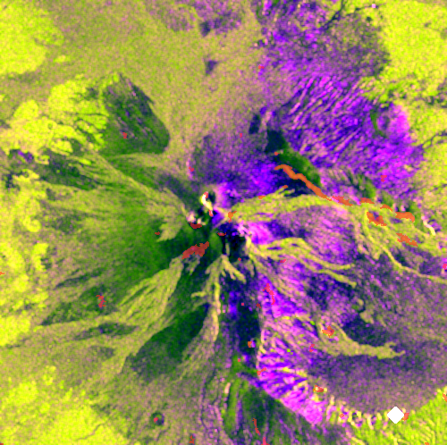
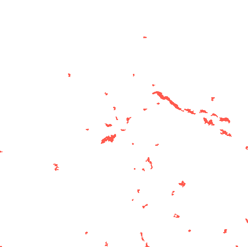
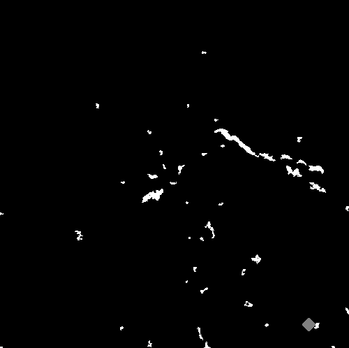
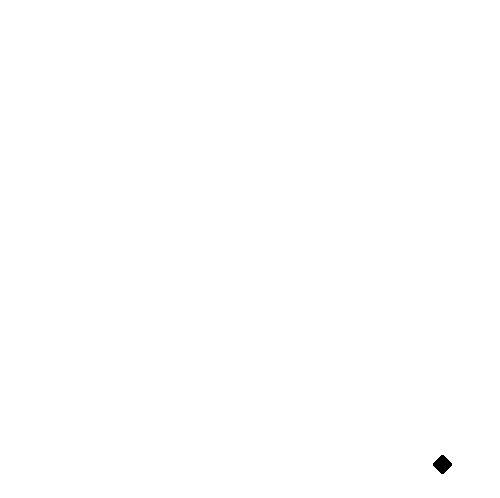
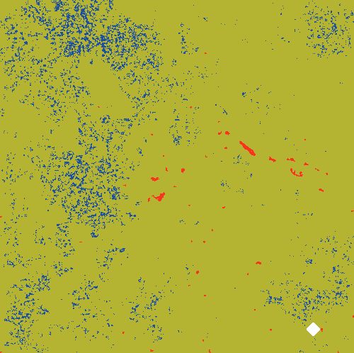
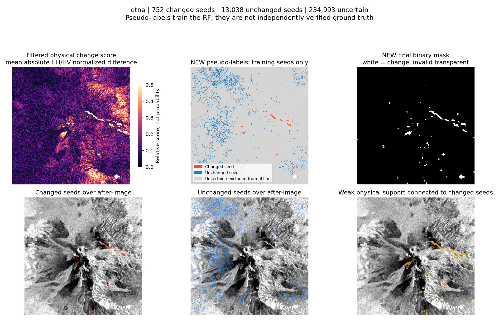

# etna

Before: **2026-07-23 04:08:29 UTC**. After: **2026-08-16 04:08:28 UTC**.

Pair-specific UCDFormer adaptation, physical-change gating and a pseudo-label-trained random forest produce the final mask. The score is not a calibrated probability; accuracy has not been independently measured.

Event context: July 23 precedes selected late-July/August phases, but Etna was already active earlier in July. August 16 captures part of a multi-phase interval, not necessarily its end. [Source](https://ingvvulcani.com/2026/08/22/etna-la-calda-estate-del-2026/).

[Acquisition timeline and per-polarization EDA](../../eda/etna/README.md).

## Images

Overview: before, after, continuous feature score and final change overlay.

Before acquisition: HH / HV / log polarization-ratio false-color SAR composite.

After acquisition: identical channel scaling, so colors can be compared with before.

Final detected change shown in red over the after acquisition.

Final binary change overlay: red means detected change; the remaining pixels are transparent.

Final binary mask: white changed, black unchanged, gray unsupported.

Model coverage: white scored, black excluded because valid context was unavailable.

Automatic seed labels: red changed, blue unchanged, yellow uncertain; not the final mask or ground truth.

Pseudo-label diagnostics: confident changed/unchanged seeds, uncertain pixels, physical-change support and final result. Seeds are automatically generated, not ground truth.

Before: `NISAR_L2_PR_GCOV_026_043_A_021_2005_DHDH_A_20260723T040829_20260723T040904_P05023_N_F_J_001`

After: `NISAR_L2_PR_GCOV_028_043_A_021_2005_DHDH_A_20260816T040828_20260816T040903_P05023_N_F_J_001`

Scored area: 99.51 km²; detected change: 1.008 km². These are areas, not accuracy metrics.

[Full run, geospatial files, checkpoint and diagnostics](../../runs/etna/README.md).

[Your earlier preferred conservative mask](../../../old/outputs/etna/refinement/conservative_candidate/README.md) is preserved separately; it uses the earlier model run plus a physical-change gate.

## Method comparison

| Variant | Detected km² | Scored km² |
|---|---:|---:|
| Trained translation + physical gate + RF | 1.008 | 99.51 |
| Physical threshold baseline; no neural model | 18.443 | 99.60 |
| Frozen VGG + physical gate + RF; no translation | 1.003 | 99.51 |

Areas are algorithm outputs, not accuracy scores; the baseline can have different valid support. The conservative settings were reused from Etna for this first pass and may omit diffuse or low-contrast change. Full disaster extent and a benefit from neural translation have not been established.

Physical threshold baseline: no neural model is used.

Frozen VGG feature comparison with physical gating and RF; the trained translator is not applied.

