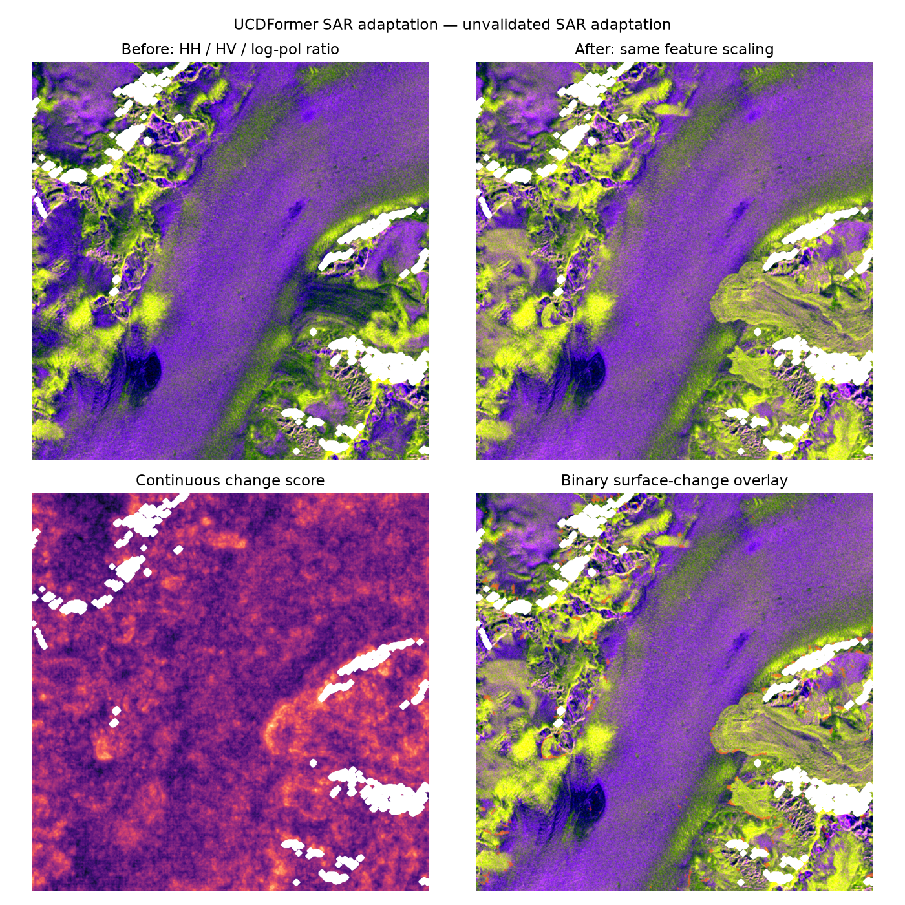
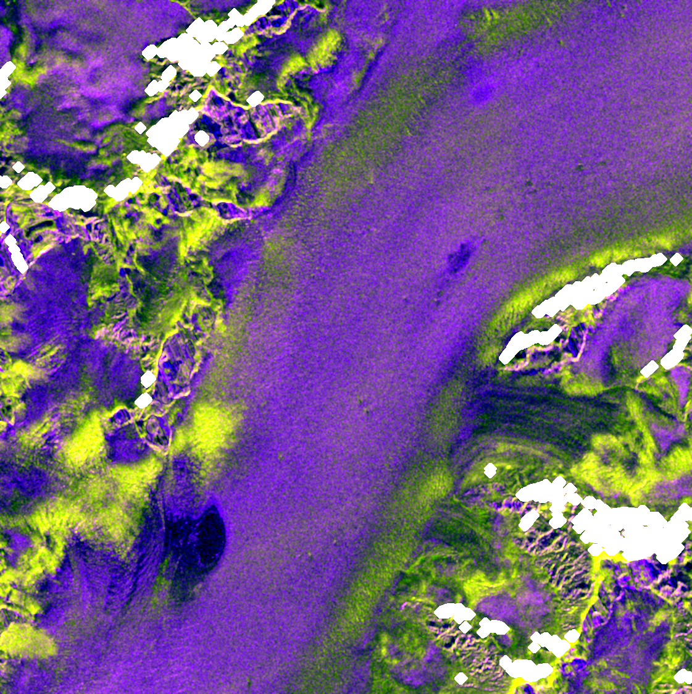
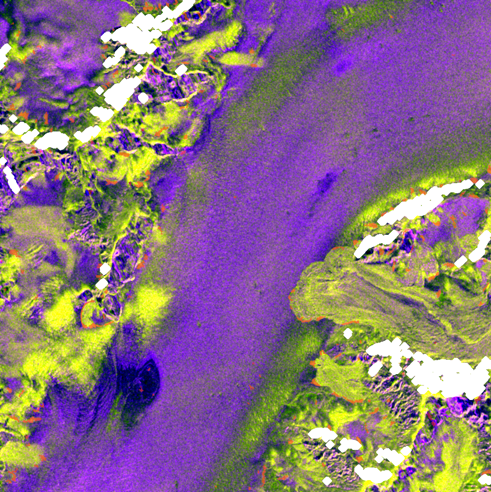
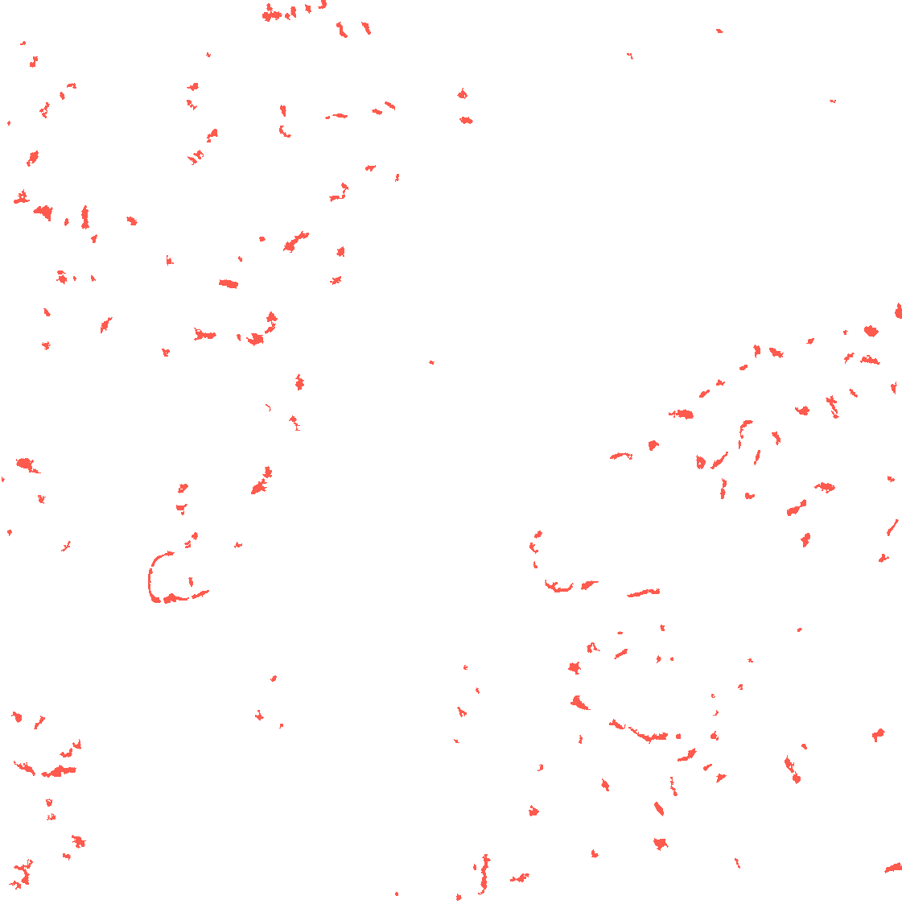
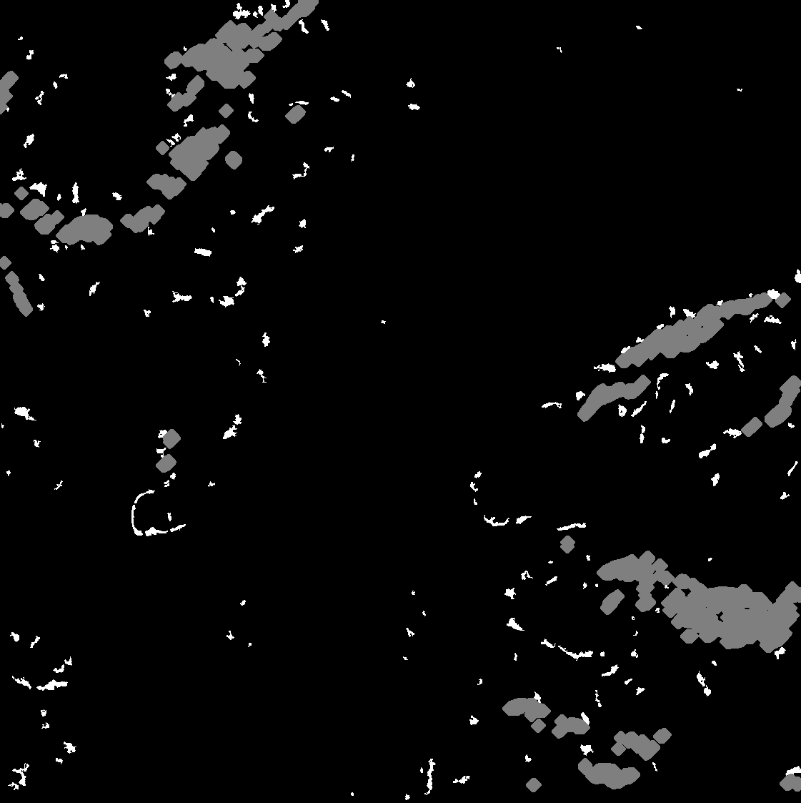
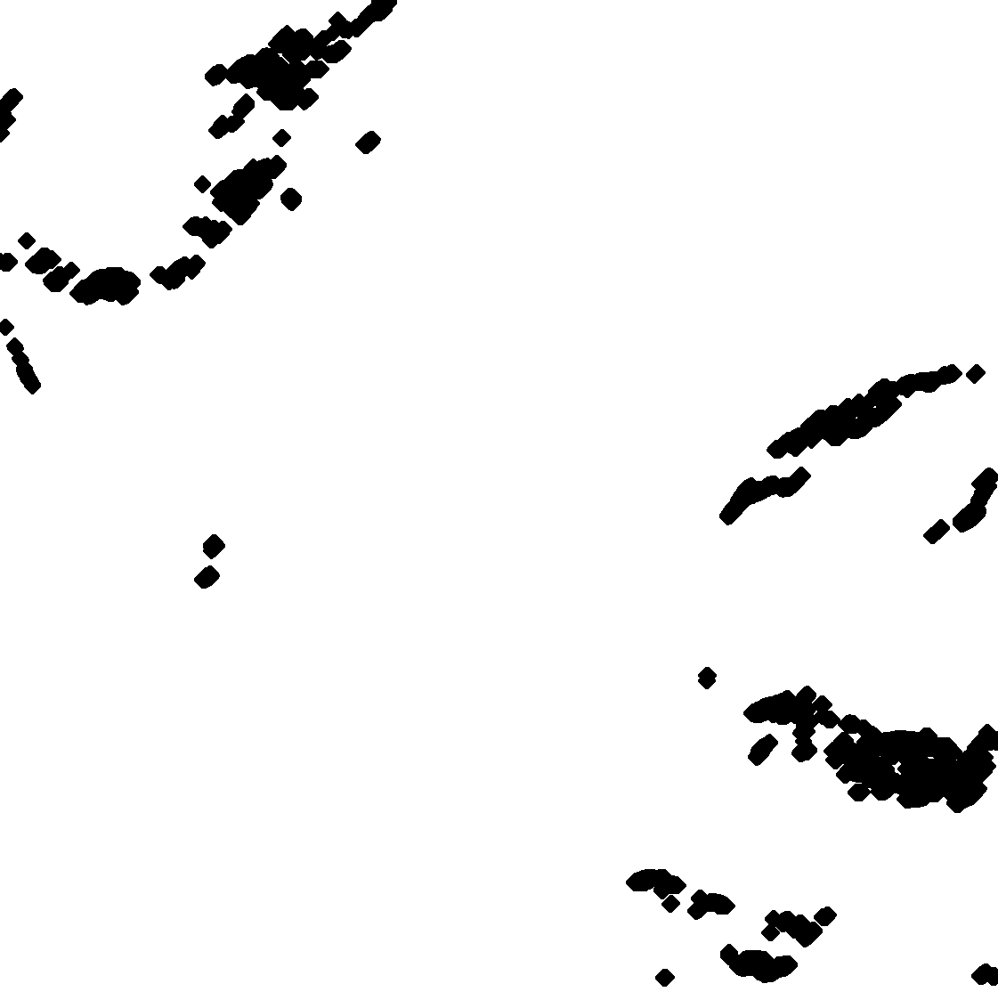
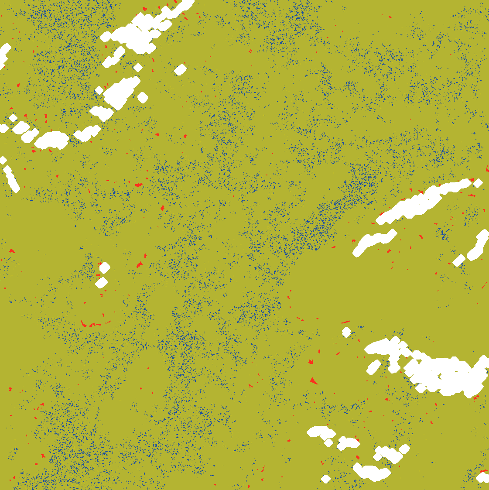
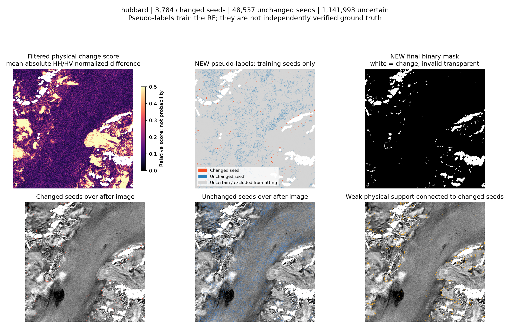

# hubbard

Before: **2025-11-26 13:32:27 UTC**. After: **2025-12-08 13:32:28 UTC**.

Pair-specific UCDFormer adaptation, physical-change gating and a pseudo-label-trained random forest produce the final mask. The score is not a calibrated probability; accuracy has not been independently measured.

Event context: November 26/December 8 bracket the earthquake. Snow, ice motion and terrain can mimic deposit-related backscatter change; Beta data. [Source](https://science.nasa.gov/earth/earth-observatory/landslide-and-avalanche-debris-litter-hubbard-glacier/).

[Acquisition timeline and per-polarization EDA](../../eda/hubbard/README.md).

## Images

Overview: before, after, continuous feature score and final change overlay.

Before acquisition: HH / HV / log polarization-ratio false-color SAR composite.

After acquisition: identical channel scaling, so colors can be compared with before.

Final detected change shown in red over the after acquisition.

Final binary change overlay: red means detected change; the remaining pixels are transparent.

Final binary mask: white changed, black unchanged, gray unsupported.

Model coverage: white scored, black excluded because valid context was unavailable.

Automatic seed labels: red changed, blue unchanged, yellow uncertain; not the final mask or ground truth.

Pseudo-label diagnostics: confident changed/unchanged seeds, uncertain pixels, physical-change support and final result. Seeds are automatically generated, not ground truth.

Before: `NISAR_L2_PR_GCOV_006_063_A_032_4005_DHDH_A_20251126T133227_20251126T133303_X05009_N_F_J_001`

After: `NISAR_L2_PR_GCOV_007_063_A_032_4005_DHDH_A_20251208T133228_20251208T133304_X05009_N_F_J_001`

Scored area: 119.43 km²; detected change: 1.518 km². These are areas, not accuracy metrics.

[Full run, geospatial files, checkpoint and diagnostics](../../runs/hubbard/README.md).

## Method comparison

| Variant | Detected km² | Scored km² |
|---|---:|---:|
| Trained translation + physical gate + RF | 1.518 | 119.43 |
| Physical threshold baseline; no neural model | 14.324 | 124.17 |
| Frozen VGG + physical gate + RF; no translation | 1.551 | 119.43 |

Areas are algorithm outputs, not accuracy scores; the baseline can have different valid support. The conservative settings were reused from Etna for this first pass and may omit diffuse or low-contrast change. Full disaster extent and a benefit from neural translation have not been established.

Physical threshold baseline: no neural model is used.

Frozen VGG feature comparison with physical gating and RF; the trained translator is not applied.

