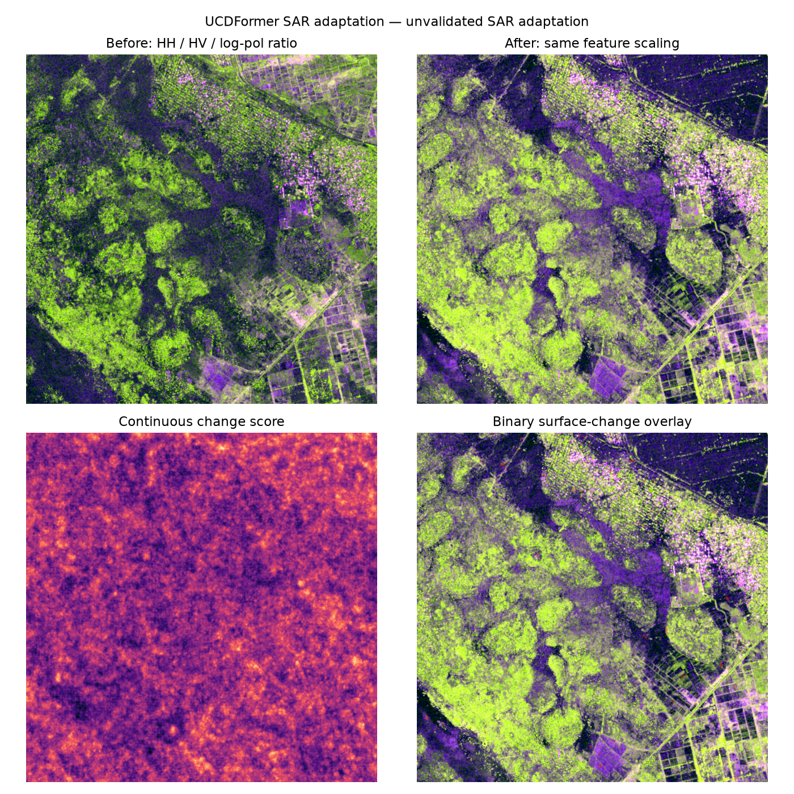
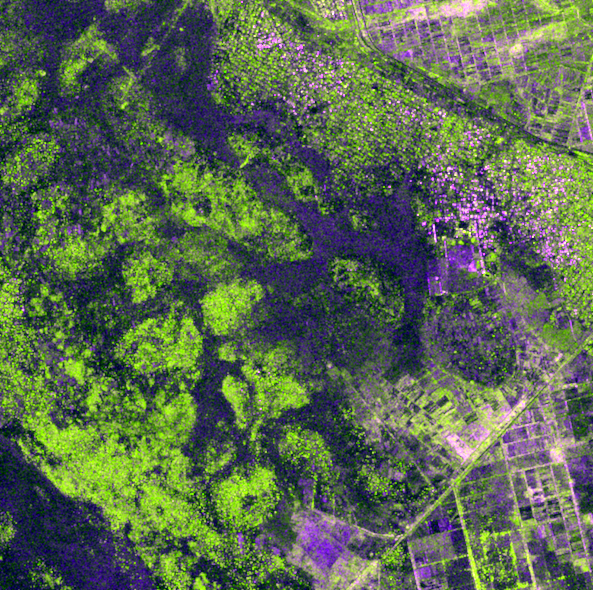
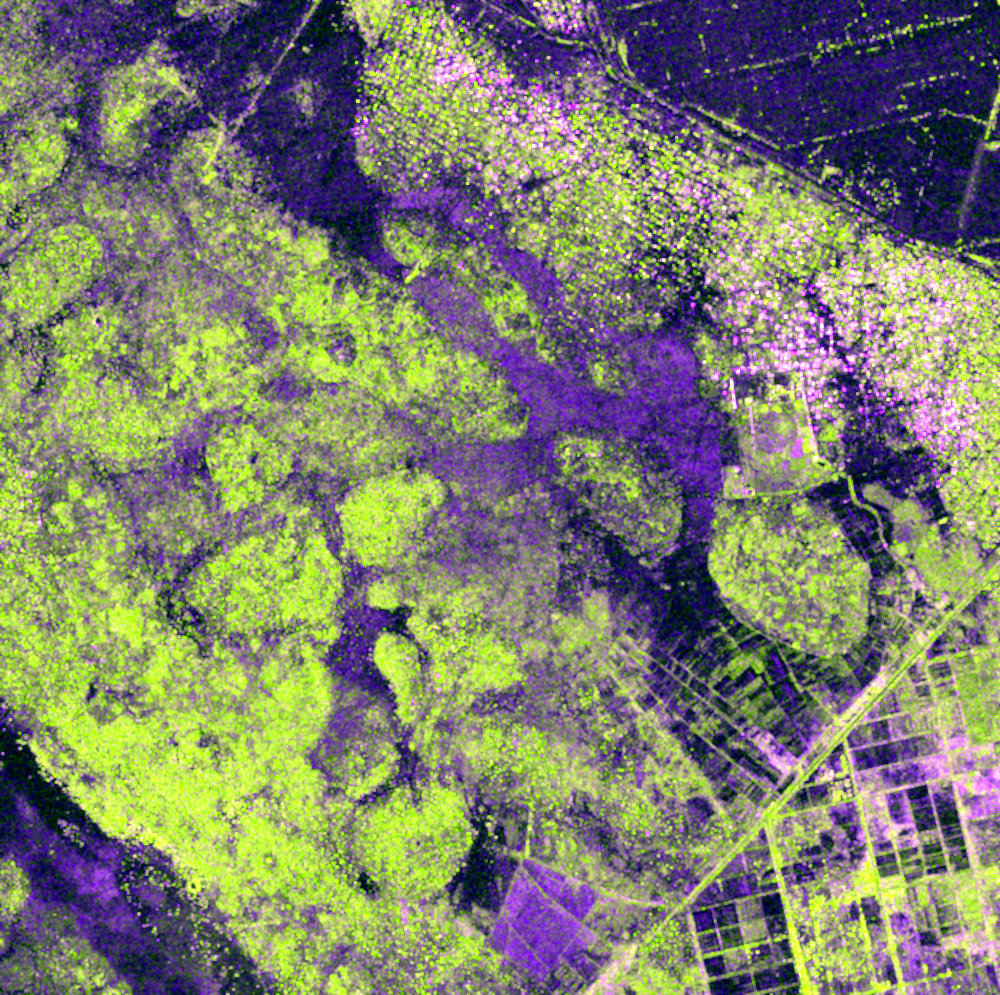
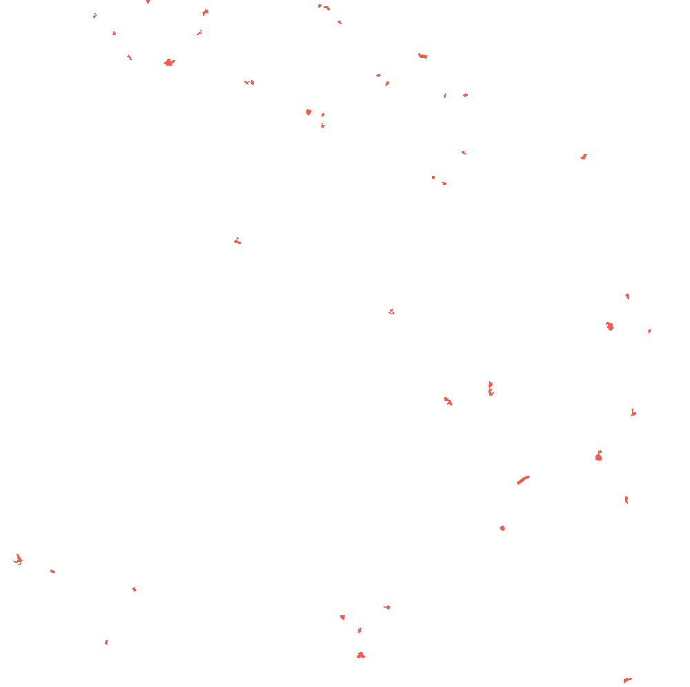
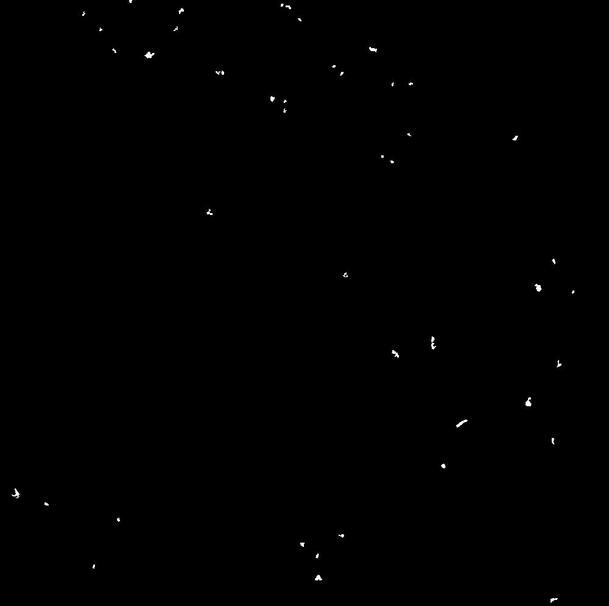
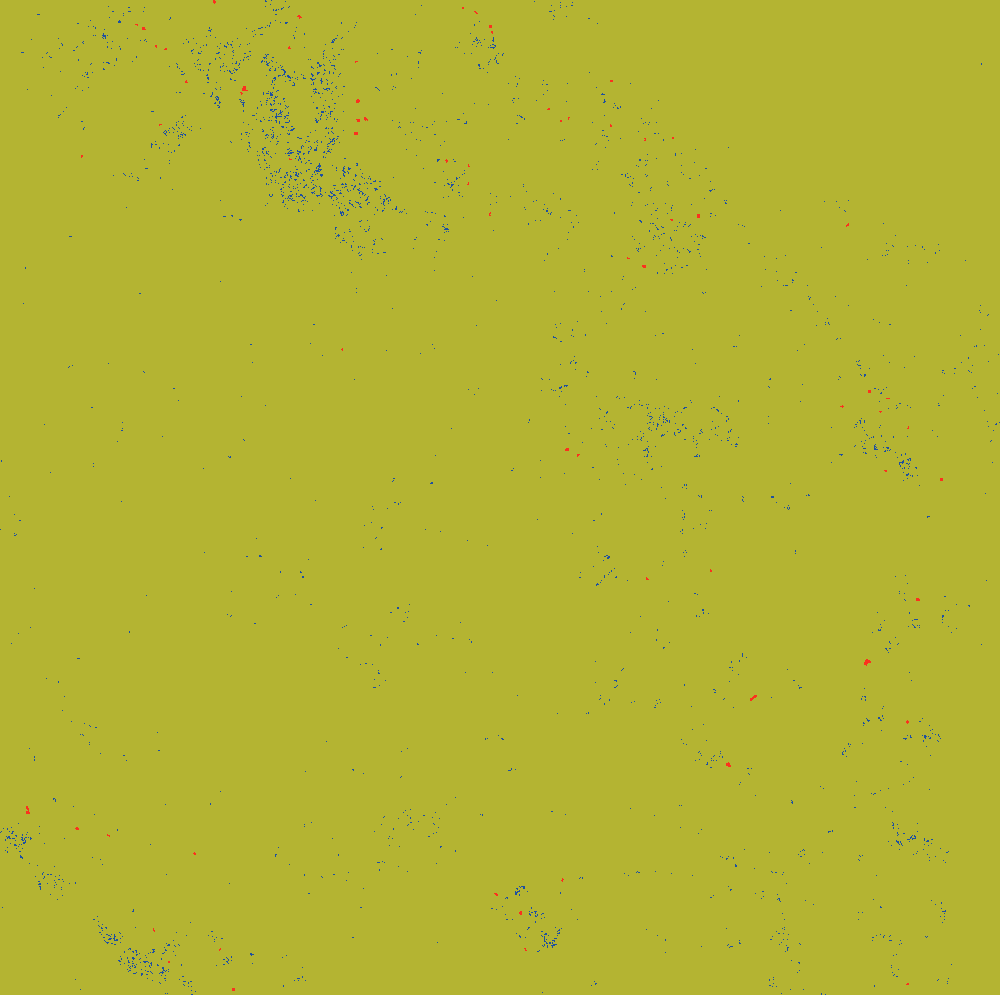
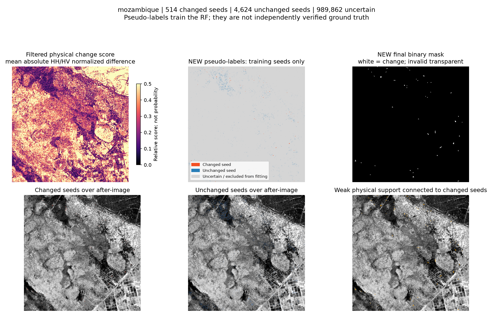

# mozambique

Before: **2026-01-05 03:42:32 UTC**. After: **2026-01-17 03:42:32 UTC**.

Pair-specific UCDFormer adaptation, physical-change gating and a pseudo-label-trained random forest produce the final mask. The score is not a calibrated probability; accuracy has not been independently measured.

Event context: NASA compares January 5 and January 17. Flooding developed over a longer rainfall interval: January 5 is the comparison image, not proven entirely pre-flood. January 17 is a during-flood acquisition; Beta calibration caveats apply. [Source](https://svs.gsfc.nasa.gov/5661).

[Acquisition timeline and per-polarization EDA](../../eda/mozambique/README.md).

## Images

Overview: before, after, continuous feature score and final change overlay.

Before acquisition: HH / HV / log polarization-ratio false-color SAR composite.

After acquisition: identical channel scaling, so colors can be compared with before.

Final detected change shown in red over the after acquisition.

Final binary change overlay: red means detected change; the remaining pixels are transparent.

Final binary mask: white changed, black unchanged, gray unsupported.

Model coverage: white scored, black excluded because valid context was unavailable.

Automatic seed labels: red changed, blue unchanged, yellow uncertain; not the final mask or ground truth.

Pseudo-label diagnostics: confident changed/unchanged seeds, uncertain pixels, physical-change support and final result. Seeds are automatically generated, not ground truth.

Before: `NISAR_L2_PR_GCOV_009_114_A_165_4005_DHDH_A_20260105T034232_20260105T034253_X05010_N_P_J_001`

After: `NISAR_L2_PR_GCOV_010_114_A_165_4005_DHDH_A_20260117T034232_20260117T034254_X05010_N_P_J_001`

Scored area: 99.50 km²; detected change: 0.166 km². These are areas, not accuracy metrics.

[Full run, geospatial files, checkpoint and diagnostics](../../runs/mozambique/README.md).

This model run covers the local training AOI. [Regional EDA](../../eda/mozambique_regional/README.md) covers the larger flood context; this local mask does not establish the full flood extent.

## Method comparison

| Variant | Detected km² | Scored km² |
|---|---:|---:|
| Trained translation + physical gate + RF | 0.166 | 99.50 |
| Physical threshold baseline; no neural model | 36.599 | 99.50 |
| Frozen VGG + physical gate + RF; no translation | 0.200 | 99.50 |

Areas are algorithm outputs, not accuracy scores; the baseline can have different valid support. The conservative settings were reused from Etna for this first pass and may omit diffuse or low-contrast change. Full disaster extent and a benefit from neural translation have not been established.

Physical threshold baseline: no neural model is used.

Frozen VGG feature comparison with physical gating and RF; the trained translator is not applied.

