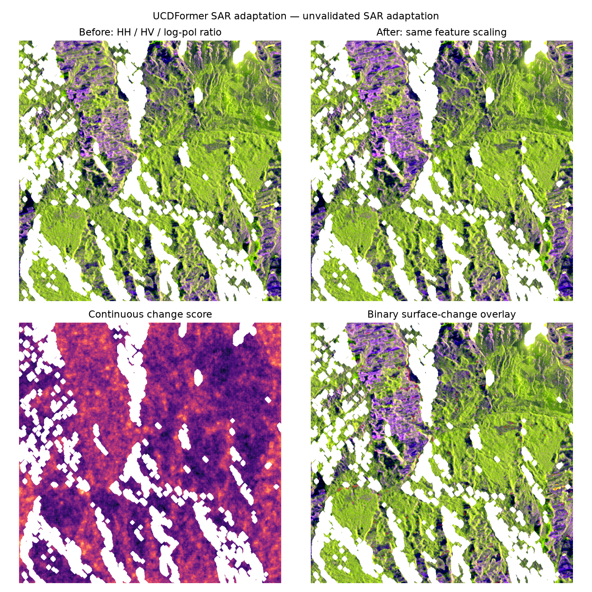
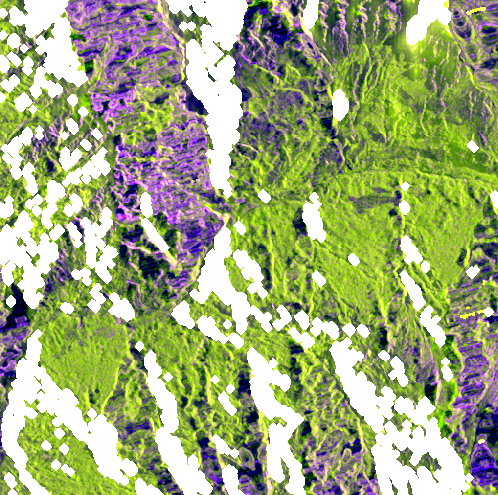
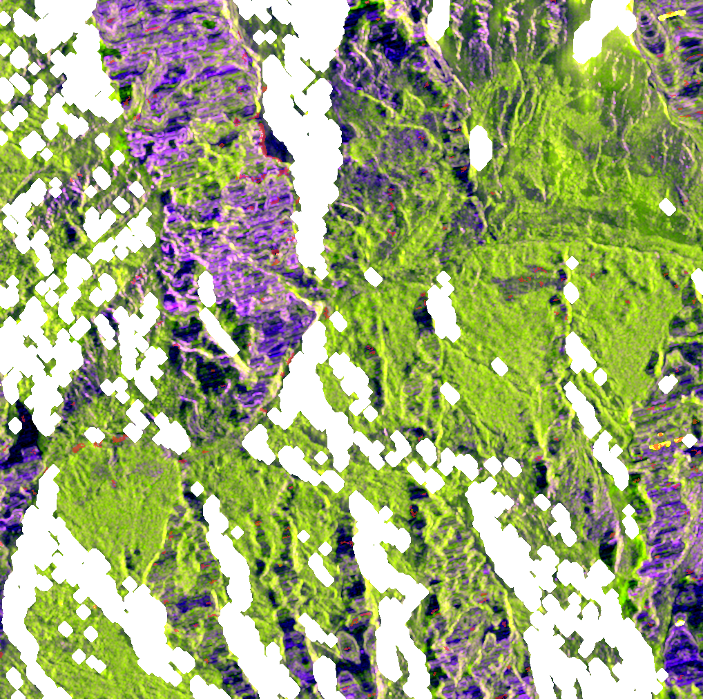
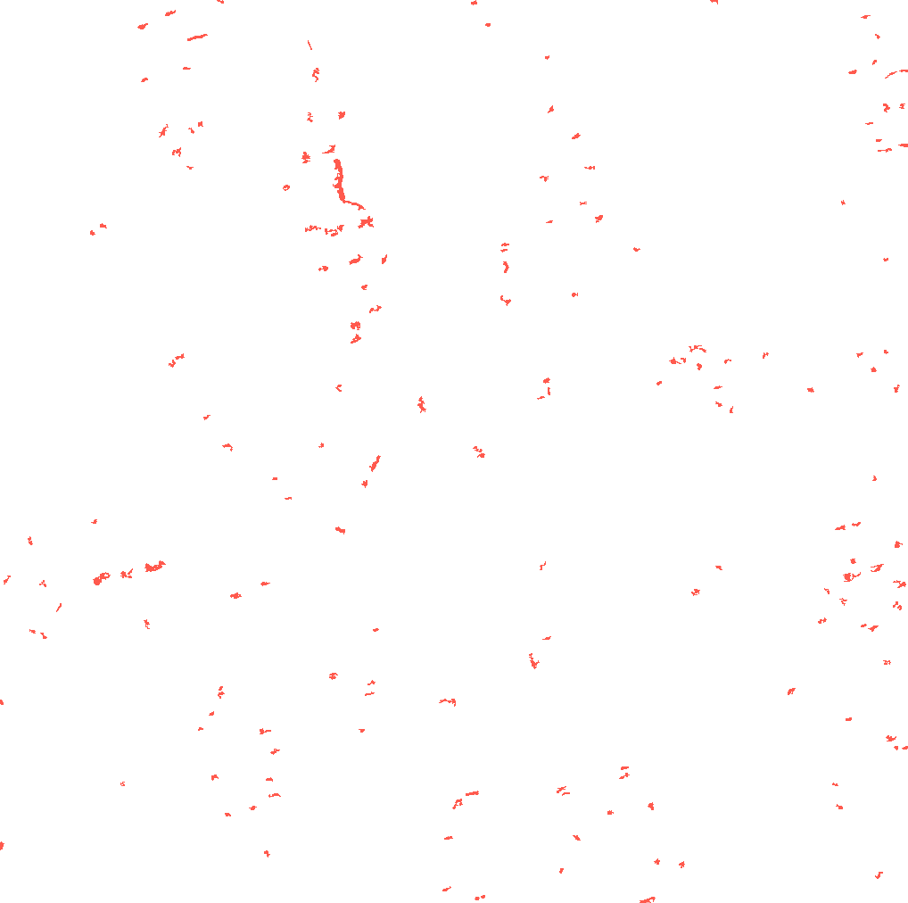
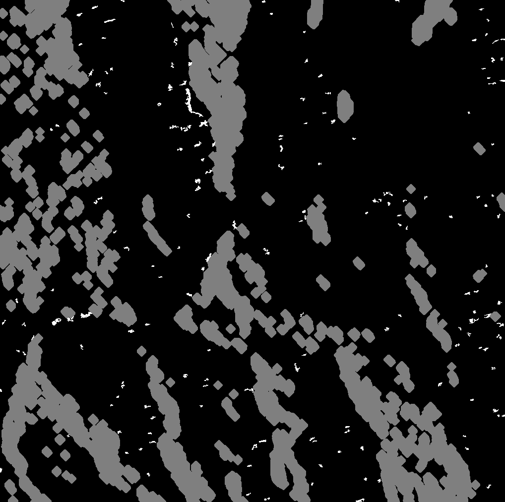
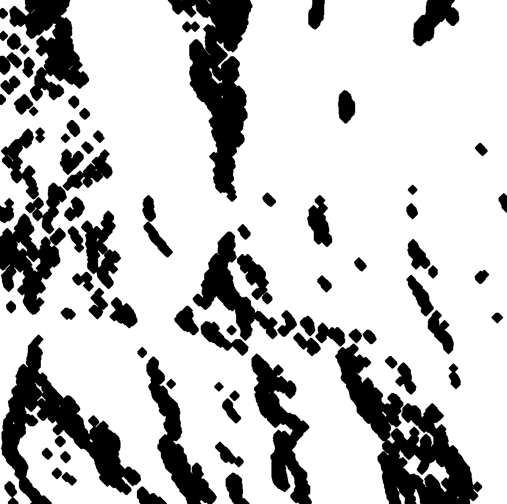
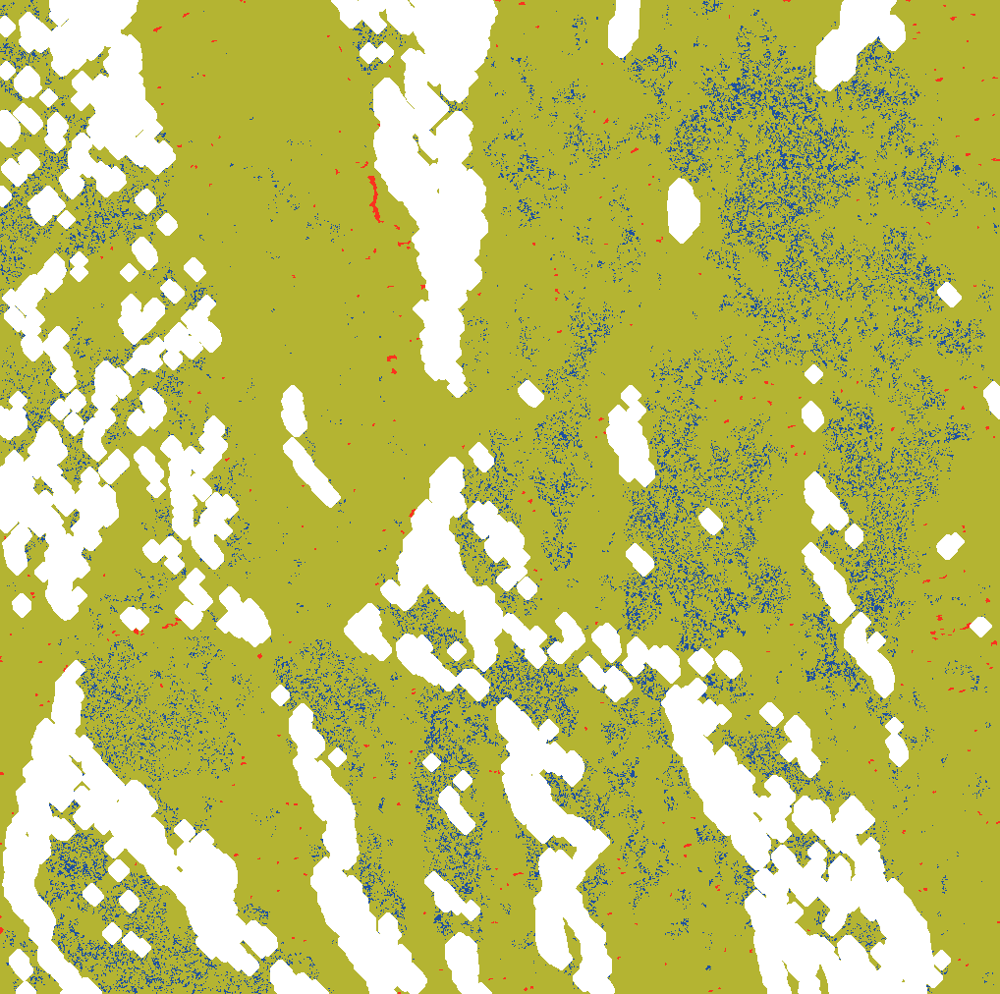
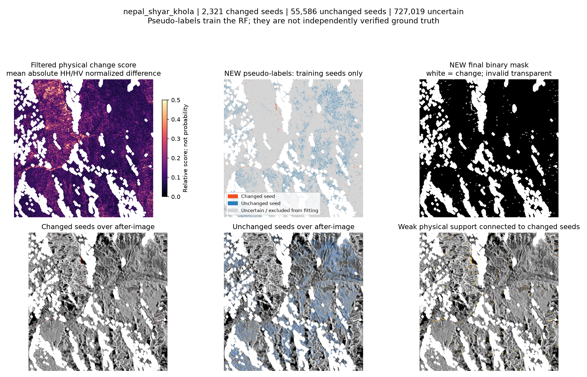

# nepal shyar khola

Before: **2026-10-06 23:39:18 UTC**. After: **2026-10-18 23:39:18 UTC**.

Pair-specific UCDFormer adaptation, physical-change gating and a pseudo-label-trained random forest produce the final mask. The score is not a calibrated probability; accuracy has not been independently measured.

Event context: October 11 avalanche/debris-flow/flood cascade. River deposits, snow and terrain can produce different radar signatures. [Source](https://eu-space.europa.eu/components/earth-observation-copernicus/image-of-the-day/landslide-triggered-flash-flood-sweeps-through-nepals-himalayan-valleys).

[Acquisition timeline and per-polarization EDA](../../eda/nepal_shyar_khola/README.md).

## Images

Overview: before, after, continuous feature score and final change overlay.

Before acquisition: HH / HV / log polarization-ratio false-color SAR composite.

After acquisition: identical channel scaling, so colors can be compared with before.

Final detected change shown in red over the after acquisition.

Final binary change overlay: red means detected change; the remaining pixels are transparent.

Final binary mask: white changed, black unchanged, gray unsupported.

Model coverage: white scored, black excluded because valid context was unavailable.

Automatic seed labels: red changed, blue unchanged, yellow uncertain; not the final mask or ground truth.

Pseudo-label diagnostics: confident changed/unchanged seeds, uncertain pixels, physical-change support and final result. Seeds are automatically generated, not ground truth.

Before: `NISAR_L2_PR_GCOV_032_098_A_016_4005_DHDH_A_20261006T233918_20261006T233952_P05023_N_F_J_001`

After: `NISAR_L2_PR_GCOV_033_098_A_016_4005_DHDH_A_20261018T233918_20261018T233952_P05023_N_F_J_001`

Scored area: 78.49 km²; detected change: 0.626 km². These are areas, not accuracy metrics.

[Full run, geospatial files, checkpoint and diagnostics](../../runs/nepal_shyar_khola/README.md).

## Method comparison

| Variant | Detected km² | Scored km² |
|---|---:|---:|
| Trained translation + physical gate + RF | 0.626 | 78.49 |
| Physical threshold baseline; no neural model | 18.738 | 94.77 |
| Frozen VGG + physical gate + RF; no translation | 0.796 | 78.49 |

Areas are algorithm outputs, not accuracy scores; the baseline can have different valid support. The conservative settings were reused from Etna for this first pass and may omit diffuse or low-contrast change. Full disaster extent and a benefit from neural translation have not been established.

Physical threshold baseline: no neural model is used.

Frozen VGG feature comparison with physical gating and RF; the trained translator is not applied.

