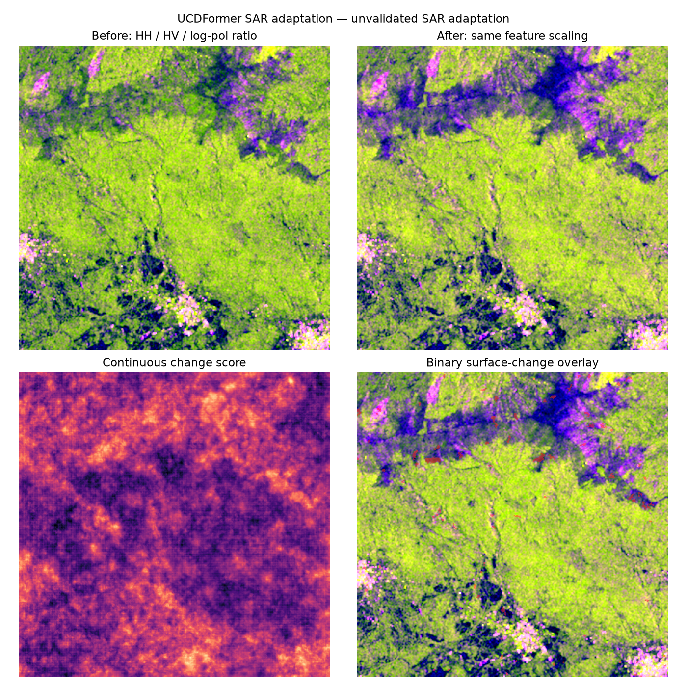
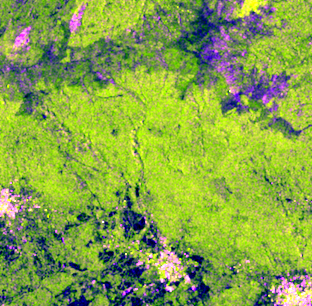
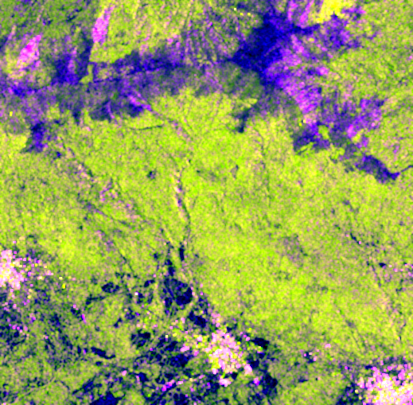
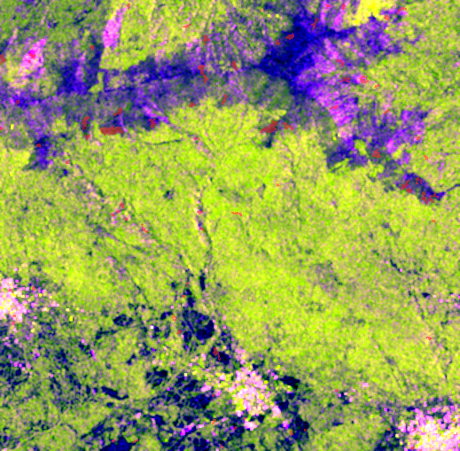
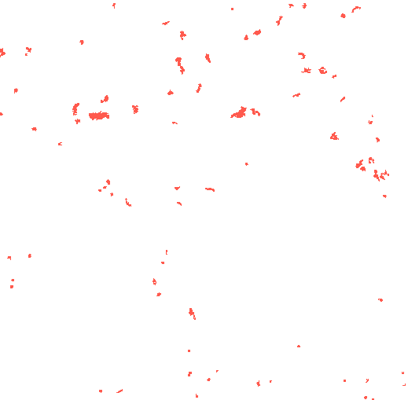
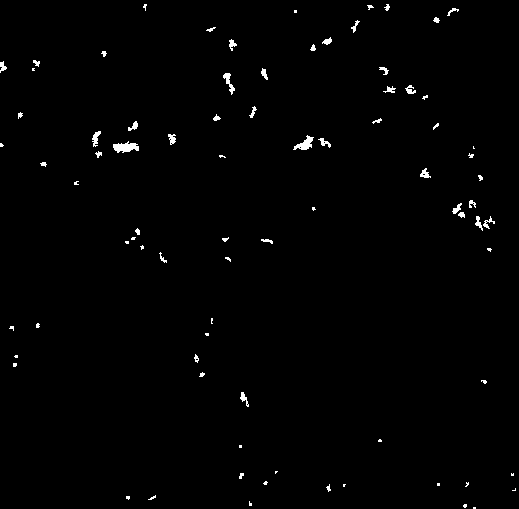
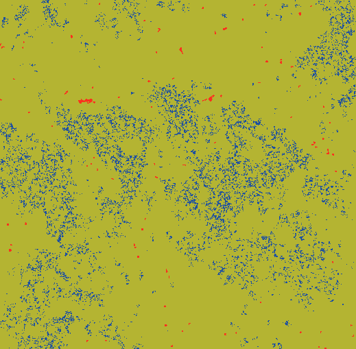
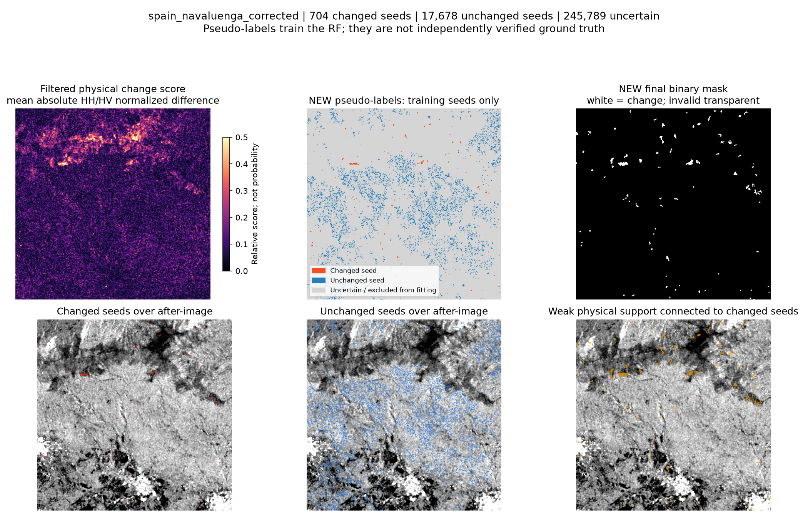

# spain navaluenga corrected

Before: **2026-07-02 05:24:02 UTC**. After: **2026-08-19 05:24:00 UTC**.

Pair-specific UCDFormer adaptation, physical-change gating and a pseudo-label-trained random forest produce the final mask. The score is not a calibrated probability; accuracy has not been independently measured.

Event context: Corrected Navaluenga south AOI selected with independently mapped fire geometry, not just the town name. July 2/August 19 use same track/frame/CRID and near-real-time orbit class. The longer interval also includes non-fire seasonal/moisture changes. CEMS August 5 optical-derived burn polygons are contextual references, not exhaustive generic-change labels. [Source](https://mapping.emergency.copernicus.eu/activations/EMSR900/).

[Acquisition timeline and per-polarization EDA](../../eda/spain_navaluenga_corrected/README.md).

## Images

Overview: before, after, continuous feature score and final change overlay.

Before acquisition: HH / HV / log polarization-ratio false-color SAR composite.

After acquisition: identical channel scaling, so colors can be compared with before.

Final detected change shown in red over the after acquisition.

Final binary change overlay: red means detected change; the remaining pixels are transparent.

Final binary mask: white changed, black unchanged, gray unsupported.

Model coverage: white scored, black excluded because valid context was unavailable.

Automatic seed labels: red changed, blue unchanged, yellow uncertain; not the final mask or ground truth.

Pseudo-label diagnostics: confident changed/unchanged seeds, uncertain pixels, physical-change support and final result. Seeds are automatically generated, not ground truth.

Before: `NISAR_L2_PR_GCOV_024_087_A_022_2005_DHDH_A_20260702T052402_20260702T052434_P05023_N_F_J_001`

After: `NISAR_L2_PR_GCOV_028_087_A_022_2005_DHDH_A_20260819T052400_20260819T052432_P05023_N_F_J_001`

Scored area: 105.67 km²; detected change: 0.957 km². These are areas, not accuracy metrics.

[Full run, geospatial files, checkpoint and diagnostics](../../runs/spain_navaluenga_corrected/README.md).

## Method comparison

| Variant | Detected km² | Scored km² |
|---|---:|---:|
| Trained translation + physical gate + RF | 0.957 | 105.67 |
| Physical threshold baseline; no neural model | 27.575 | 105.67 |
| Frozen VGG + physical gate + RF; no translation | 1.057 | 105.67 |

Areas are algorithm outputs, not accuracy scores; the baseline can have different valid support. The conservative settings were reused from Etna for this first pass and may omit diffuse or low-contrast change. Full disaster extent and a benefit from neural translation have not been established.

Physical threshold baseline: no neural model is used.

Frozen VGG feature comparison with physical gating and RF; the trained translator is not applied.

